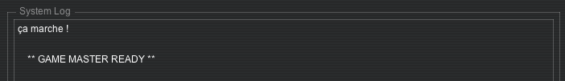
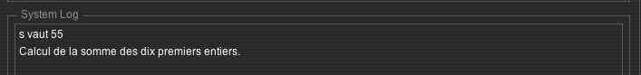
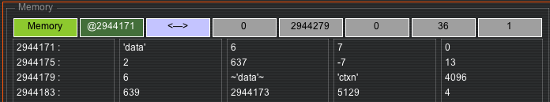
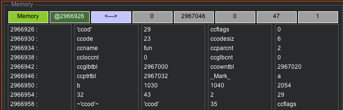
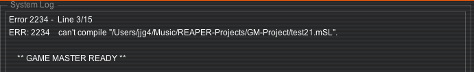

# Programmer avec mSL

Ce chapitre reprend, de manière plus progressive, les notions présentées au chapitre précédent. Nous nous intéresserons aux concepts les plus simples de la programmation, tels qu’ils sont incarnés en *mSL*. Le chapitre suivant décrit plus formellement le langage, et le chapitre 13 les aspects les plus évolués : multiprogrammation, processus, messages. Les exemples de ce chapitre ont été écrits pour le Game Master, mais ils s’exécutent de la même façon dans tout plug-in de CMGS ; les fonctions propres à chaque plug-in sont décrites dans son manuel.

Ce chapitre a donc pour ambition de présenter assez brièvement une introduction à la programmation, destinée au programmeur débutant qui désire écrire ses premiers scripts en *mSL*. Il ne propose rien de compliqué ni de révolutionnaire, mais gageons que même le programmeur chevronné y apprendra quelque chose à l’occasion... Celui-ci peut aussi passer immédiatement au chapitre suivant, où *mSL* est présenté plus en détail et plus formellement.

Sa lecture est cependant conseillée à tous. Assurez-vous de comprendre les codes sources proposés et les explications correspondantes. Ne sautez pas d’étapes ! Chaque exemple, chaque paragraphe vise à vous apporter quelques concepts supplémentaires...

## Introduction

Une vision ancienne, mais toujours d’actualité, est de considérer qu’un ordinateur est composé d’une « *Mémoire Centrale* » (« MC »), comportant un nombre élevé, mais fini, de *cellules* pouvant contenir des valeurs numériques, et d’une « *Unité* *Centrale* » (« UC ») pouvant exécuter des *« programmes* », réalisant des « *algorithmes* », dont le rôle est de modifier les valeurs des cellules de la mémoire, jusqu’à obtention du résultat attendu.

Cette vision est présentée ici car elle est explicitement intégrée à *mSL* (et à *eel2*, aka « *JS* », son langage d’implémentation). Chaque cellule de la « MC » est désignée par son adresse, un nombre entier allant de 0 jusqu’au numéro de la dernière cellule, par exemple 16777215 (2 puissance 24 moins 1), ou encore 4294967295 (2 puissance 32 moins 1), etc. Le langage « *mSL* », et sa base d’implantation « *JS* », assimilent la mémoire à un tableau de nombres décimaux, chaque cellule de la mémoire pouvant contenir n’importe quel nombre décimal compris entre « -1.7976931348623158E+308 » et « 1.7976931348623158E+308 ^[Cette notation se lit « 1 virgule 7976931348623158 multiplié par 10 élevé à la puissance 308 », ce qui est un très grand nombre, 1 suivi de 308 zéros – pour comparaison, on évalue actuellement le nombre d’atomes de l’univers à « seulement » 2 multiplié par 10 élevé à la puissance 79, soit, en décimal, 2 suivi de 79 zéros.] ».

En utilisant *mSL*, il est possible de lire ou d’écrire n’importe quel mot de cette mémoire, au moyen d’une séquence d’instructions similaires aux suivantes ^[Nous utiliserons cette typographie particulière chaque fois que nous ferons référence à des éléments du langage mSL, identificateurs, valeurs numériques, fragments de code, etc.] :

```
var M = 0;
M[7231];
M[537328] = 7;
```

La première ligne déclare une variable (déclaration « `var` ») de nom « `M` », et lui donne, par l’opérateur « `=`», la valeur numérique « 0 ». La seconde ligne permet de lire la cellule de mémoire d’adresse 7231. Dans la troisième ligne, la cellule de mémoire située à l’adresse 537328 est modifiée pour contenir la valeur 7. Toutes les instructions *mSL* se terminent par le caractère « `;` », qui marque la fin de l’instruction. Notons que les espaces (blanc, tabulation, passage à la ligne) sont facultatifs, sauf lorsqu’ils sont utilisés pour séparer deux séquences de lettres (ici, « `var` » et « `M` »).

**Note : accès à la mémoire**

Ce n’est bien sûr pas un hasard que la variable « `M`» soit initialisée à 0. La *sémantique* de cette construction « `A[B]`», dite *indexation*, est de consulter la cellule de mémoire *d’adresse* `A+B`. Il est équivalent d’écrire `B[A]`, voire `0[A+B]` ou `(A+B)[0]`. `M[7231]` est donc équivalent à `0[7231]`, ou encore à `7001[230]` ! De même, « `A[B]=C` » copie dans la cellule de mémoire de numéro `A+B` la valeur `C`.

Notons encore que, bien que ces trois lignes correspondent à un programme syntaxiquement correct, celui-ci, si on l’exécutait, irait lire la mémoire du plug-in, et surtout tenterait d’y écrire, ce qui serait très probablement la source d’erreurs fort difficiles à détecter. Par sécurité, *mSL* n’autorise donc l’écriture indexée « `A[B]=C` » qu’à l’intérieur d’un *tableau* (voir le § 11.6) : la troisième ligne arrête le programme avec une erreur (1630). La fonction « `poke` » permet, en connaissance de cause, d’écrire à une adresse quelconque (voir le chapitre suivant).

En général, l’on n’a pas besoin de lire ou d’écrire spécifiquement une adresse particulière de la mémoire, mais pour programmer un algorithme, il est très souvent nécessaire d’utiliser plusieurs quantités différentes, que l’on puisse aisément distinguer les unes des autres. Pour ce faire, nous allons demander à *mSL* d’associer pour nous une cellule de la mémoire de son choix, à un nom que nous avons choisi. Cette association (*nom* et *cellule de mémoire*) est dite « *variable* ». Cette demande se fait sous la forme « `var toto;` » dans laquelle `var` est un *mot clef* du langage (on ne peut l’utiliser *que* pour déclarer une variable), et `toto` est le nom que nous avons choisi pour cette variable. L’affectation va nous permettre de changer la valeur d’une variable.

Illustrons ces concepts par quelques exemples simples.

On veut calculer la somme des 10 premiers nombres entiers. On peut bien entendu écrire (*algo 1.1*) :

```
var s = 1 + 2 + 3 + 4 + 5 + 6 + 7 + 8 + 9 + 10;
```

qui répond parfaitement à la question, ou encore (*algo 1.2*) :

```
var s = (10 * (10 + 1)) / 2;
```

qui fait appel à la formule bien connue, *N* × (*N* + 1) / 2, instanciée ici pour *N* = 10.

Dans ces deux écritures, qui toutes deux vont associer la valeur 55 à la variable `s`, on trouve une *déclaration* de variable, « `var s;`» et une *affectation*, « `s = expression;` » qui consiste à modifier la valeur de la cellule de mémoire désignée par le nom placé à gauche du symbole d’affectation, « `=` », pour la remplacer par le résultat de l’expression située à droite de ce signe. Ici, la déclaration et l’affectation sont combinées en une expression unique.

Dans les *expressions*, l’on utilise des symboles traditionnels de l’informatique, « `+`», « `*`», « `/`» pour représenter *l’addition*, la *multiplication* et la *division*. On parle en général *d’opérateurs* pour désigner ces symboles qui font référence aux opérations mathématiques classiques. Les parenthèses permettent d’indiquer qu’une sous-expression doit être calculée en priorité, ici « `(10 + 1)`». Ajoutons la *soustraction*, « `-` », et nous avons fait le tour des principales opérations arithmétiques. Enfin, vous l’avez remarqué, les instructions se terminent par un *point-virgule*, « `;` ».

Dans nombre de langages de programmation, le concept de *déclaration* est associé à celui de « *type* ». Ainsi, le langage « C » distingue les *entiers*, déclarés par « `int`», nombres sans partie décimale, des *réels*, déclarés par « `float`», qui peuvent avoir une partie décimale. L’une des raisons est que cette distinction correspond au fait que les machines sur lesquelles existent des compilateur « C » proposent différents types de représentations internes des données, destinés à optimiser l’écriture et l’efficacité des programmes. Le langage « *eel2* » (ou « JSFX ») ne propose pour sa part qu’un type unique de représentation des données, le « *flottant double* ». Cette restriction se retrouve de fait dans le langage *mSL*. Dès lors, pourquoi imposer une déclaration des variables ? « eel2 » considère que tout identificateur rencontré dans un programme est implicitement déclaré comme variable. Ceci simplifie les envolées lyriques dans lesquelles le programmeur laisse les instructions couler à flots, et ne désire pas, en outre, s’ennuyer à déclarer les variables qu’il invente au fil de la plume... Mais est aussi extrêmement propice à la création de bugs souvent difficiles à détecter, dans lesquelles une faute de frappe fait utiliser une autre variable que celle que l’on avait prévue ! C’est pour cette raison que j’ai choisi de rendre obligatoire la déclaration de toutes les variables utilisées, ce qui, rétroactivement, me semble aujourd’hui avoir été une sage décision.

## Premiers éléments

Un programme va consister en une séquence d’instructions. Nous les écrirons à raison d’une par ligne, et elles vont s’exécuter dans l’ordre, l’une après l’autre, de haut en bas. Ainsi, dans l’exemple suivant, tentez de calculer après chaque instruction, les valeurs des deux variables « `a` » et « `b` ». Que constatez-vous ?

```
var a, b;
a = 17;
b = 11;
a = a + b;
b = a - b;
a = a - b;
```

Après la déclaration des variables et leur initialisation, les trois dernières lignes constituent un « petit algorithme » qui, vous l’avez deviné, échange les valeurs de « `a` » et « `b` ».

Revenons à notre somme des dix premiers entiers, et proposons encore une autre approche, moins appropriée dans ce cas précis puisque des solutions plus simples existent, mais intéressante par sa généralité (*algo 1.3*).

```
var s;
var i;
s = 0;
i = 0;
while (i < 10) (
    i = i + 1;
    s = s + i;
);
```

L’écriture semble compliquée, mais nous abordons ici le cœur de l’algorithmique : construire l’équivalent d’une « recette de cuisine », compréhensible par la machine, qui puisse aboutir au résultat désiré.

Les quatre premières lignes sont des opérations qui sont maintenant familières : déclarations et *initialisations* de variables. La cinquième ligne propose une construction nouvelle, qui est une *répétition d’instructions*, souvent dite *boucle*. Sa syntaxe est la suivante :

```
while ( condition ) ( instructions );
```

Le mot-clef « `while` » détermine la nature de l’instruction, les parenthèses et le point-virgule final sont obligatoires. Ces éléments, dans cet ordre précis, constituent la *syntaxe* de l’instruction. La *sémantique* de cette instruction est la suivante : tant que le calcul de l’expression « `condition`» donne le résultat *vrai*, l’instruction *while* va exécuter les « `instructions`» placées dans le second couple de parenthèses. Rappelons ici que le format des instructions est libre : un espace est nécessaire pour séparer deux identificateurs (par exemple le *mot-clef* `var` et l’*identificateur* `s`), mais les espaces sont facultatifs lorsqu’il n’y a pas d’ambigüité. On peut en placer autant que l’on le souhaite, insérer des sauts de ligne, etc. ; ainsi l’instruction while est ici écrite sur quatre lignes.

La condition de l’instruction *while*, dans notre cas, est l’expression « `i < 10`» qui se lit « *i inférieur à 10* », dont la valeur est *vrai* si la variable « `i`» est plus petite que 10, et *faux* sinon. Notons que lorsqu’une variable est utilisée dans une expression, elle est remplacée par le contenu de la cellule qu’elle désigne.

Soyons conscient également de l’aspect *temporel* lié à un programme. La machine évalue *dans l’ordre* du texte source les instructions successives du programme. Après la déclaration des variables `s` et `i`, `s` reçoit la valeur 0, puis `i` reçoit la valeur 0, puis l’instruction *while* s’exécute.

Lors de l’exécution du *while*, « `i < 10` » est calculée une première fois. Il s’agit d’une comparaison, que l’on peut lire « i est-il strictement inférieur à 10 ? ». Pour ce faire, la variable `i` est remplacée par sa valeur, 0, et comme 0 est plus petit que 10, le résultat de la comparaison est *vrai*. Ce résultat implique que le calcul des instructions situées entre les parenthèses du *while* va être effectué. La première expression, « `i + 1` » calcule donc « `0 + 1` », et le résultat est mis « dans » `i`, qui vaut maintenant 1. La seconde expression est « `s + i` », les variables ont pour valeurs 0 pour `s`, 1 pour `i`, et le résultat est 1, qui est placé dans `s`.

Le premier calcul de la condition ayant fourni la valeur *vrai*, la boucle *while* va donc être exécutée à nouveau. Le nouveau calcul de « `i < 10`» se résume à « `1 < 10` » qui est *vrai*, ce qui va entraîner une nouvelle exécution des instructions internes du *while*. Celles-ci vont affecter « `1 + 1`», soit 2, à `i`, puis « `1 + 2`», soit 3, à `s`. La condition du *while* étant toujours *vraie*, les calculs vont maintenant changer `i` en 3, et `s` en 6. A l’itération suivante, `i` va devenir 4 et `s` 10. Puis les variables vont prendre les valeurs 5 et 15, 6 et 21, 7 et 28, 8 et 36, 9 et 45, puis 10 et 55. A ce moment là, le test de la condition « `i < 10` » calcule « `10 < 10` », qui donne le résultat *faux*, ce qui interrompt l’exécution de la boucle. Le résultat attendu, 55, est dès lors disponible dans la variable `s`.

L’intérêt de cette approche est qu’elle nous fournit un *mécanisme*, dans lequel une variable, `i`, prend toutes les valeurs entre 1 et 10 (ou entre 1 et un nombre quelconque), à partir duquel on peut résoudre différents problèmes similaires.

Par exemple, si nous transformons la seconde instruction de la boucle en (*algo 1.4*) :

```
s = s + (i * i);
```

nous calculons non pas la somme des nombres de 1 à 10, mais la somme des *carrés* de ces nombres.

De même, « `s = s + sqrt(i)`» va nous donner la somme des *racines carrées* des nombres de 1 à 10. Il est fait cette fois appel à la fonction prédéfinie `sqrt` (*square root*). Signalons à cette occasion que la *syntaxe* d’un appel de fonction est :

```
nom_de_la_fonction ( paramètres )
```

Les parenthèses suivant le nom de la fonction sont partie intégrante de la syntaxe d’appel de la fonction. C’est entre celles-ci que l’on place les valeurs à partir desquelles la fonction va effectuer son travail. Une fonction utilise habituellement une ou deux valeurs, mais certaines peuvent en attendre un grand nombre, séparées les unes des autres par des virgules, ou encore... aucune ! Une fonction est un « *petit algorithme* » qui s’applique à des données – le terme précis est « *paramètre* ». Une fonction va utiliser un seul paramètre (comme `sqrt`), ou, comme nous le verrons bientôt, deux (`min` ou `max`), plus (`sprintf`), voir aucun (`stralloc`). Ces paramètres sont placés entre parenthèses, séparés par des virgules, à la suite du nom de la fonction. Cette *construction syntaxique* constitue un *appel de fonction*. Tout comme `A[B]` indique une indexation, `F(X)`, `G()` ou `H(X,Y,Z)` dénotent des appels de fonctions, avec 1, 0 et 3 paramètres respectivement.

Enfin, écrire « `s = s * i`» (à condition d’avoir initialisé `s` à 1 et non à 0) va nous fournir le produit des dix premiers entiers, c’est-à-dire la *factorielle* de 10.

**Exemple 2**

Continuons avec notre travail sur les boucles. Nous allons cette fois faire appel à un *tableau*. Alors que les variables que nous avons utilisées jusqu’à présent (telles `s` et `i`) sont associées à un unique élément, qui est une cellule de la mémoire, les tableaux font référence à une séquence d’éléments, c’est-à-dire plusieurs cellules de mémoire consécutives, désignées par leur numéro dans la séquence, de 0 à *N* − 1.

Le problème que l’on se pose est de trouver le plus grand élément, dans un tableau de dix valeurs. Nous allons donner le nom de « `liste`» à notre tableau, et le définir par :

```
var liste = data (7 11 43 0 2 1 1 637 -7 13);
```

La variable « `liste`» est bien sûr déclarée par « `var`», et reçoit comme valeur un tableau de dix éléments, construit par l’opération « `data`». Le résultat de cette opération est l’adresse du premier élément de ce tableau. La valeur 7 est donc accessible par l’expression « `liste[0]` », la valeur 11 par « `liste[1]` », etc. (*algo 2.1*) :

```
var liste = data (7 11 43 0 2 1 1 637 -7 13);
var s;
var i;
s = 0;
i = 0;
while (i < 10) (
    s = max(s, liste[i]);
    i = i + 1;
);
```

L’écriture, là encore, est similaire à la boucle précédente. Nous faisons appel à l’indexation, symbolisée par les crochets, pour consulter les valeurs des éléments successifs de « `liste` », ainsi qu’à la fonction « `max` ». Celle-ci attend deux valeurs (ou, plus généralement, deux expressions), et nous renvoie la plus grande de ces deux valeurs. A chaque cycle, la plus grande valeur trouvée jusqu’à présent, `s`, est comparée avec l’élément courant, `liste[i]`, et la plus grande de ces deux valeurs est conservée. En utilisant la fonction « `min` » (minimum de deux valeurs) au lieu de « `max` », on obtient encore un nouvel algorithme, recherchant, lui, le plus petit élément du vecteur.

Précisons que « `data` », « `liste` », « `i` », « `s` », « `max` », « `while` », etc., au-delà de tout rôle sémantique particulier, sont des *identificateurs*. Syntaxiquement, un identificateur se construit comme une suite de lettres et de chiffres, débutant par une lettre, et pouvant comprendre le caractère « \_ » assimilé à une lettre.

## Premiers essais

Il est temps de passer à la pratique... Et tout d’abord, se pose la question : comment rédiger un programme *mSL* ?

Le Game Master ne contient pas d’éditeur de texte. Le langage d’implantation, « JS », se prête mal à ce genre d’exercice, et il existe par ailleurs nombre d’outils, quels que soient la machine et le système utilisés, qui permettent cette activité. L’approche proposée est donc de créer, de manière indépendante de REAPER et du Game Master, un fichier texte contenant le programme *mSL* à tester, puis de charger ce programme dans le Game Master. Pour ma part, j’opère sur Mac, et j’utilise *VS Code* (*Visual Studio Code*), mais à l’occasion *TextEdit* ou *Vim* conviennent parfaitement.

Essayons donc notre premier programme. Lancer *TextEdit* (ou l’équivalent sur votre machine), et dans la fenêtre qui s’affiche (intitulée « Sans Titre »), taper :

```
var s = (10 * (10 + 1)) / 2;
```

sauvegarder sous le nom « `test1.mSL`». Le premier programme est écrit – car oui, cette expression est aussi un programme complet, prêt à être exécuté. Il nous faut maintenant le soumettre au Game Master. Que va-t-il se passer ?

Lorsque le Game Master reçoit un « programme » (c’est le cas si on lui propose un fichier dont le nom se termine par l’extension « `.mSL`»), il considère que ce fichier doit être exécuté. Dans un premier temps, le texte du fichier est soumis à un module spécialisé, le compilateur *mSL*, qui va analyser ce texte, et, si la syntaxe en est correcte, va générer une structure de donnée, le « code objet » représentant ce programme prêt à être exécuté (c.f. § 11.7). Dans le cas contraire, il imprime un message d’erreur, indiquant un type d’erreur, un numéro de ligne, et une position dans la ligne. Si tout s’est bien passé, le Game Master va construire un processus destiné à l’exécution du programme, processus qui est confié à un interprète qui va se charger d’exécuter le code ainsi mis en forme. Là aussi, une erreur peut être détectée, qui provoquera l’arrêt de l’exécution.

Soumettons donc notre programme au Game Master. Pour ceci, afficher dans le Finder le répertoire dans lequel vous avez effectué la sauvegarde, faire un clic-gauche sur le nom du fichier, et, en gardant cette touche enfoncée, glisser le fichier sur la barre horizontale des tabulations, en haut de la fenêtre du Game Master (ai-je précisé qu’il fallait d’abord lancer l’exécution de celui-ci ?). Relâcher la touche de la souris : le programme vient de s’exécuter, dans la plus parfaite discrétion.

Le but d’un script étant d’être le plus discret possible et de se faire oublier, on ne peut bien sûr rien reprocher au système. Pourtant, dans cette phase d’apprentissage, il serait bien de disposer un petit retour du système. Pour ceci, nous allons utiliser la fonction « `GM_Log` » qui va permettre de visualiser un message dans le journal du Game Master, affiché par le module « System Log ». Ajoutons une seconde ligne :

```
GM_Log("ça marche !");
```

Nous faisons ici appel à la fonction « `GM_Log`» – nous avons déjà rencontré d’autres fonctions comme `sqrt`, `max`, etc. – mais ici la donnée transmise à la fonction (on parle de *paramètre*) est un nouvel objet : une *chaîne de caractères*, qui est une suite de lettres, chiffres, espaces et tous ces autres signes bizarres du clavier, suite placée entre doubles quotes, « `"` ».

{width=15.716cm}

Exécutons le programme ainsi modifié : notre message s’affiche dans le module « System Log » (c.f. fig. 11.1). Nous voici donc rassurés sur le fait que le calcul se soit exécuté.

Bien sûr, il n’est pas très satisfaisant de ne pas voir le résultat du programme. Transformons le en ceci :

```
GM_Log("Calcul de la somme des dix premiers entiers.");
var s = (10 * (10 + 1)) / 2;
var str = stralloc();
sprintf(str, "s vaut %d", s);
GM_Log(str);
```

{width=15.716cm}

La figure 11.2 nous montre le résultat de cette nouvelle exécution. Cette fois-ci, un premier message indique la raison d’être du programme. Puis vient le calcul proprement dit, et enfin trois lignes qui ne servent qu’à afficher le résultat.

Analysons-les en détail. « `var str = stralloc();`» déclare une nouvelle variable, de nom « `str` », et lui affecte le résultat de l’appel de la fonction « `stralloc` ». Celle-ci ne prend pas de données, mais fournit à chaque appel une nouvelle *chaîne de caractères*, qui va pouvoir être modifiée par le programme. La ligne suivante nous montre un appel d’une fonction très spéciale, `sprintf`, dont le rôle est de représenter, sous la forme d’une séquence de caractères, des valeurs numériques quelconques. Le premier paramètre est la chaîne que nous venons d’obtenir, à l’intérieur de laquelle va s’exécuter l’édition. Le second paramètre est le *format* d’édition. Dans cet exemple, la séquence de deux caractères « `%d` » indique qu’un nombre va être affiché sous la forme d’un *entier*. Cette description de format de représentation peut être associée à d’autres caractères, qui vont être reproduits tels quels. Cette « *spécification de sortie* » est représentée par une chaîne de caractères, qui est le second élément de l’appel de la fonction. Le premier élément est une chaîne de caractères, à l’intérieur de laquelle va être éditée la valeur numérique, et le troisième élément de l’appel est la valeur à éditer. Enfin, la ligne suivante imprime la valeur de la variable `str`, qui désigne la chaîne de caractères qui sert de support à l’édition. On notera que le « System Log » édite le dernier message reçu en haut de sa fenêtre, « poussant » les autres vers le bas. Les messages venus d’un programme se lisent donc de haut en bas en ordre inverse de leur arrivée.

Transformons de même notre programme de recherche du plus grand entier d’un tableau :

```
GM_Log("Recherche du plus grand élément d’un tableau.");
var liste = data (7 11 43 0 2 1 1 637 -7 13);
var s; var i;
s = 0; i = 0;
while (i < 10) (
    s = max(s, liste[i]);
    i = i + 1;
);
var str = stralloc();
sprintf(str, "s vaut %d", s);
GM_Log(str);
```

Nous obtenons dans le *log* la sortie suivante :

```
s vaut 637
Recherche du plus grand élément d’un tableau.
```

Ce qui nous conforte dans l’idée que notre programme est correct. Mais est-ce bien certain ? Le fait d’avoir un programme qui s’exécute sans erreur et fournit la valeur attendue n’implique pas forcément qu’il soit juste... Reprenons notre exemple, calculons cette fois avec d’autres données le *plus petit* élément, en utilisant la fonction `min`. Le texte devient :

```
GM_Log("Recherche du plus petit élément d’un tableau.");
var liste = data (5 7 328 2 110 220 380 1138 334 17);
var s; var i;
s = 0; i = 0;
while (i < 10) (
    s = min(s, liste[i]);
    i = i + 1;
);
var str = stralloc();
sprintf(str, "s vaut %d", s);
GM_Log(str);
```

L’exécution ne lasse pas de nous surprendre :

```
s vaut 0
Recherche du plus petit élément d’un tableau.
```

La raison, nous la découvrons assez vite : nous avons choisi « `0` » comme valeur initiale de « `s` », un nombre plus petit que tous ceux du tableau ! Au fil des itérations de notre boucle *while*, du fait que les éléments du tableau sont tous strictement positifs, et donc plus grands que notre point de départ, 0, la variable `s` va garder cette dernière valeur. Il est clair que « 0 » n’était pas le meilleur choix comme valeur initiale.

Revenons sur nos premiers algorithmes. Dans chacun, une variable, qui va être le résultat, part d’une valeur initiale, et évolue au fur et à mesure que l’opération progresse jusqu’à contenir le résultat. La formulation même de la question, ou de la finalité de l’algorithme, nous fournit une indication précise : calcul de la « somme » des dix premiers entiers, du « produit » de ces entiers, du « plus petit » ou du « plus grand » des éléments d’un tableau. La fonction essentielle impliquée dans ces algorithmes est l’addition, la multiplication, le maximum ou encore le minimum. Dans ces cas là, il est souvent pertinent de choisir comme « valeur résultat » de départ *l’élément* *neutre* de la fonction concernée : « 0 » et « 1 » respectivement pour l’addition et la multiplication. Plus généralement, l’élément neutre *e* d’une fonction *f* définie sur un ensemble *E* est tel que ∀ *x* ∈ *E*, *f*(*x*, *e*) = *f*(*e*, *x*) = *x*. Pour le maximum, cet élément est le plus petit nombre représentable sur la machine, soit −∞ si ce concept est accessible dans le langage, ou encore, dans notre cas, « -1.7976931348623158E+308 », puisque *mSL* travaille avec des flottants 64 bits à la norme IEEE 754. Pour le minimum, l’élément neutre est la valeur opposée, « 1.7976931348623158E+308 ». Pour faire fonctionner correctement notre programme, il suffit donc de remplacer « `s = 0;` » par « `s = 1.7976931348623158E+308;` ».

Signalons une autre approche : lorsque le concept est de calculer une somme, un produit, un maximum ou un minimum d’un ensemble, on peut utiliser n’importe quel élément de l’ensemble comme point de départ. Le plus simple est souvent de prendre le premier élément, et de débuter l’algorithme à partir de la seconde position. Voici un exemple ainsi modifié :

```
GM_Log("Recherche du plus grand élément d’un tableau.");
var liste = data (7 11 43 0 2 1 1 637 -7 13);
var s; var i;
s = liste[0]; i = 1;
while (i < 10) (
    s = max(s, liste[i]);
    i = i + 1;
);
var str = stralloc();
sprintf(str, "s vaut %d", s);
GM_Log(str);
```

Notons que « `s`» prend maintenant la valeur du premier élément, de numéro « 0 », et que la boucle débute à l’indice « `i = 1;` ».

L’algorithme suivant va nous permettre de trouver la position du plus petit élément d’un tableau :

```
GM_Log("Indice du plus petit élément d’un tableau.");
var liste = data (7 11 43 0 2 1 1 637 -7 13);
var s, i;
s = 0; i = 1;
while (i < 10) (
    ((liste[i] < liste[s]) ? (s = i;););
    i = i + 1;
);
var str = stralloc();
sprintf(str, "s vaut %d", s);
GM_Log(str);
```

Ligne 3, nous utilisons l’écriture « `var s, i;`» pour déclarer les deux variables en une seule instruction. Nous faisons également appel, ligne 6, à une construction nouvelle, *l’instruction conditionnelle*. Celle-ci obéit à l’une des deux syntaxes suivantes :

```
( ( condition ) ? ( si_vrai_alors_ceci ); );
( ( condition ) ? ( si_vrai_alors_ceci ) : ( sinon_celà ); );
```

Avouons immédiatement que toutes les parenthèses ne sont pas indispensables. J’utilise ici les parenthèses externes pour m’assurer que le tout constitue une instruction, et les parenthèses internes pour m’assurer de délimiter correctement la « *condition* », la partie « *alors\_ceci* » et la partie « *sinon\_celà* », cette dernière pouvant être facultative (première syntaxe).

Les éléments importants sont le « `?` » qui termine la condition, et le « `:` » qui introduit le « sinon ».

Dans notre algorithme, « `s` » représente l’indice (le numéro) du plus petit élément trouvé jusqu’alors. Lorsque le test « `liste[i] < liste[s]`» nous dit que le nouvel élément courant de la liste, d’indice « `i` », est plus petit que celui déjà trouvé, on change la valeur de « `s` » pour désigner ce nouvel élément.

## Opérateurs, fonctions, expressions et instructions

Nous avons jusqu’à présent manipulé des variables, qui peuvent référencer un élément unique de la mémoire (on parle de variables *simples* ou de *scalaires*), ou une séquence d’éléments, les *tableaux*.

Les calculs s’effectuent sur ces données au moyen d’*opérateurs* (« `+`», « `-`», etc.) ou de *fonctions* (« `max` », « `min` », « `sqrt` », etc.) qui sont des objets similaires, aux détails de syntaxe près. Cette syntaxe, justement, a été choisie pour rendre plus familière l’écriture des programmes. Les signes les plus proches de la représentation mathématique usuelle ont été choisis pour représenter les opérations correspondantes. Les caractères disponibles sur le clavier étant en nombre limité, des *noms* (ou *identificateurs*) sont utilisés pour représenter les autres fonctions.

De même, la notation mathématique traditionnelle utilise des conventions spécifiques pour décider quelle opération est exécutée avant telle autre. Ainsi, dans la fameuse écriture *ax*² + *bx* + *c*, on se souvient que *x*² est calculé en priorité, que *ax*² et *bx* contiennent des multiplications implicites (pour *a* × *x*² et *b* × *x*), qui s’exécutent sous la forme des produits de *a* par *x*² et de *b* par *x*, et que viennent enfin les additions.

On retrouve de même dans le langage *mSL* des priorités entre les opérateurs. Dans une expression qui contient des additions et des multiplications, les multiplications s’effectuent en priorité. Notre trinôme du second degré s’écrit ainsi en *mSL* « `a*x*x+b*x+c` », où « `x*x` » traduit *x*², en utilisant les fonctions que nous connaissons déjà, mais on peut aussi écrire, d’une manière encore plus proche de l’originale, « `a*x^2+b*x+c` ». Ici, l’opérateur « `^` » représente l’élévation à la puissance, et est plus prioritaire que la multiplication. « `x^2` » est donc calculé en priorité, puis viennent les produits, puis les additions. Si plusieurs opérateurs de même priorité sont utilisés dans une expression (« `1+2+3+4+5+6+7+8+9+10` »), les calculs s’effectuent en général de gauche à droite ; ici, on ajoute au résultat de « `1+2` » la valeur « `3` », puis à « `6` » la valeur « `4` », etc. Dans le doute, ou au besoin, ajoutons des parenthèses autour du calcul que l’on veut prioritaire. Ainsi « `1+2*3` » vaut « `7` », mais « `(1+2)*3` » vaut « `9` ».

Il existe en *mSL* de multiples niveaux de priorités, supposés incarner ceux que l’on retrouve en mathématique, et censés alléger l’écriture en évitant de multiplier les parenthèses. Ce n’est pas faux, mais souvenons nous que les parenthèses, même surnuméraires, ne coûtent rien si elles permettent de se conforter dans l’idée que ce que l’on a écrit est bien ce que l’on désirait obtenir. Notons que l’affectation, « = » est considérée comme un opérateur de très basse priorité. « `y=a*x^2+b*x+c`» calcule la valeur du trinôme avant de l’affecter à la variable « `y` ».

Le problème des priorités ne se pose pas avec les fonctions : une fonction s’applique aux données encloses entre parenthèses placées à sa suite. Ainsi, dans la traduction de *r*₁ = (−*b* + √(*b*² − 4*ac*)) / 2*a* :

```
r1=(-b+sqrt(b^2-4*a*c))/(2*a)
```

il est nécessaire d’utiliser des parenthèses pour délimiter les arguments de la division, mais la fonction « `sqrt` » s’applique directement au résultat de l’expression entre parenthèses qui la suit (nous introduisons ici, en catimini, l’opérateur *opposé*, noté « `-` » qui s’applique à la seule donnée située à sa droite — on peut considérer que « `-b` » est une notation raccourcie pour « `0-b` »).

Une expression est une combinaison « syntaxiquement correcte » de valeurs, de variables, d’opérateurs, d’appels de fonctions, et de parenthèses. On remettra à plus tard la définition formelle du terme « syntaxiquement correct ». Il est bon que l’intuition du programmeur se développe peu à peu : s’il comprend ce qu’il vient d’écrire, la syntaxe est assez probablement correcte ! La plupart des erreurs sont dues à l’oubli d’une parenthèse ou d’un point-virgule...

Une instruction est une expression suivie d’un point-virgule « `;` ». Alors que l’ordre précis d’exécution d’une expression dépend des opérateurs, fonctions, parenthèses et autres règles du langage, les instructions d’un programme sont exécutées les unes à la suite des autres, dans l’ordre d’écriture du programme.

Notons encore que l’on peut aussi rajouter des parenthèses autour d’une expression sans changer sa signification, et qu’une instruction, placée entre parenthèses, est assimilée à une expression. Remarquons encore l’indentation des lignes de code pour les expressions situées à l’intérieur des boucles, indentation qui n’a rien d’obligatoire mais qui permet au relecteur de mieux appréhender la structure d’un programme.

## Recherche et Tri d’éléments

Effectuer une recherche ou un tri d’élément sont des opérations fréquentes en informatique. Nous savons déjà comment rechercher le plus grand ou le plus petit élément dans un tableau. Que faire si nous recherchons maintenant les deux plus petits éléments ? Reprenons notre algorithme, réécrit pour utiliser l’élément neutre de l’opération minimum :

```
GM_Log("Indice du plus petit élément d’un tableau.");
var liste = data (7 11 43 0 2 1 1 637 -7 13);
var s, e, i;
s = -1; e = 1.7976931348623158E+308; i = 0;
while (i < 10) (
    ((liste[i] < e) ? (s = i; e = liste[i];););
    i = i + 1;
);
var str = stralloc();
sprintf(str, "s vaut %d", s);
GM_Log(str);
```

Dans notre algorithme, nous gardons maintenant dans « `s`» l’indice du plus petit élément, et dans « `e` » sa valeur. Nous pourrions imaginer deux boucles successives pour rechercher nos deux plus petits éléments (nommons les « `s` » et « `t` ») :

```
GM_Log("Indice du plus petit élément d’un tableau.");
var liste = data (7 11 43 0 2 1 1 637 -7 13);
var s, t, e, f, i;
s = -1; e = 1.7976931348623158E+308; i = 0;
while (i < 10) (
    ((liste[i] < e) ? (s = i; e = liste[i];););
    i = i + 1;
);
t = -1; f = 1.7976931348623158E+308; i = 0;
while (i < 10) (
    ((liste[i] < f) ? (t = i; f = liste[i];););
    i = i + 1;
);
var str = stralloc();
sprintf(str, "liste[%d] vaut %d", s, e);
GM_Log(str);
sprintf(str, "liste[%d] vaut %d", t, f);
GM_Log(str);
```

Bien sûr, cette version découvre deux fois de suite la même valeur ! Pour être assuré que « `t` » va recevoir une valeur différente de celle de « `s` », il suffit, dans la seconde boucle, de rajouter la condition que le « `i` » courant soit différent de l’indice du plus petit élément précédemment trouvé, « `s` » :

```
(((liste[i] < f) && (i != s)) ? (t = i; f = liste[i];););
```

La condition que nous ajoutons, « *i est différent de s* », s’écrit « `i!=s`», où « `!=`» (sans espace entre les deux caractères) représente l’opération de comparaison « différent ». Les deux conditions testées sont reliées entre elles par l’opérateur « `&&`», « *et* », qui rend « *vrai* » si ses deux opérandes sont vrais. Nous utilisons ici des parenthèses (redondantes) autour de ces deux conditions, et autour de l’ensemble de la condition.

Cette fois, nous obtenons correctement dans « `s` » l’indice du plus petit élément (8), et dans « `t` » celui du second plus petit (3).

Peut-on découvrir les deux éléments « `s`» et « `t`» en une seule boucle, au lieu d’opérer avec deux boucles successives ? Par exemple, que donnerait ceci, et pourquoi ?

```
var liste = data (7 11 43 0 2 1 1 637 -7 13);
var s, t, e, f, i;
s = t = -1;
e = f = 1.7976931348623158E+308;
i = 0;
while (i < 10) (
    ((liste[i] < e) ? (s = i; e = liste[i];););
    (((liste[i] < f) && (i != s)) ? (t = i; f = liste[i];););
    i = i + 1;
);
var str = stralloc();
sprintf(str, "liste[%d] vaut %d", s, e);
GM_Log(str);
sprintf(str, "liste[%d] vaut %d", t, f);
GM_Log(str);
```

On pourrait modifier ad vitam ce programme pour rechercher les trois plus petits éléments, puis les quatre plus petits, etc... Après avoir réalisé que l’on ne peut découvrir le plus petit élément de rang « N » sans avoir découvert les « N-1 » précédents.

Introduisons maintenant une autre stratégie : nous allons *modifier* le tableau initial, pour introduire en tête le plus petit élément. Pour ceci, on cherche la position du plus petit élément, puis on échange celui-ci avec le premier. Voici le programme :

```
GM_Log("Placer en tête le plus petit élément.");
var liste = data (7 11 43 0 2 1 1 637 -7 13);
var s, e, i;
s = -1; e = 1.7976931348623158E+308; i = 0;
while (i < 10) (
    ((liste[i] < e) ? (s = i; e = liste[i];););
    i = i + 1;
);
// échange, par l’intermédiaire d’une variable « x »
var x; x = liste[0]; liste[0] = liste[s]; liste[s] = x;
var str = stralloc();
sprintf(str, "minimum : %d", liste[0]);
GM_Log(str);
```

La modification que nous avons introduite est l’échange proprement dit ; celui-ci est réalisé par la ligne qui suit le commentaire – ligne débutant par le symbole « `//`», dont le contenu est ignoré par l’exécutant du script et destiné aux seuls lecteurs humains du programme. Le fait d’avoir placé en tête le plus petit élément nous assure que tous ceux qui suivent sont supérieurs ou égaux à celui-ci.

On peut effectuer la même opération, pour placer le second plus petit élément à la suite du premier : il suffit cette fois d’ajouter une seconde boucle, qui va débuter à l’indice suivant, 1 au lieu de 0 :

```
GM_Log("Placer en tête les plus petits éléments.");
var liste = data (7 11 43 0 2 1 1 637 -7 13);
var s, e, i;
s = -1; e = 1.7976931348623158E+308; i = 0;
while (i < 10) (
    ((liste[i] < e) ? (s = i; e = liste[i];););
    i = i + 1;
);
// échange, par l’intermédiaire d’une variable « x »
var x; x = liste[0]; liste[0] = liste[s]; liste[s] = x;
s = -1; e = 1.7976931348623158E+308; i = 1;
while (i < 10) (
    ((liste[i] < e) ? (s = i; e = liste[i];););
    i = i + 1;
);
// échange, par l’intermédiaire d’une variable « x »
var x; x = liste[1]; liste[1] = liste[s]; liste[s] = x;
var str = stralloc();
sprintf(str, "minima : %d %d", liste[0], liste[1]);
GM_Log(str);
```

Sous cette forme, on voit émerger un schéma : placer à la suite les uns des autres les éléments découverts, jusqu’à obtenir le nombre d’éléments désirés : 2, 3, 5, 10... Sautons les étapes intermédiaires, et, au lieu de placer les boucles numéro 3, 4, etc. les unes à la suite des autres, construisons une nouvelle boucle *englobant* la recherche initiale, dans laquelle, pour généraliser notre approche, on désigne par « `N` » le nombre d’éléments du tableau, et « `P` » le nombre d’éléments recherchés :

```
GM_Log("Placer en tête les plus petits éléments.");
var liste = data (7 11 43 0 2 1 1 637 -7 13);
var N = 10;
var P = 5;
var s, e, i, j, x;
j = 0;
while (j < P) (
    s = -1; e = 1.7976931348623158E+308; i = j;
    while (i < N) (
        ((liste[i] < e) ? (s = i; e = liste[i];););
        i = i + 1;
    );
    // échange, par l’intermédiaire d’une variable « x »
    x = liste[j]; liste[j] = liste[s]; liste[s] = x;
    j = j + 1;
);
var str = stralloc();
sprintf(str, "minima : %d %d %d %d %d",
             liste[0], liste[1],
             liste[2], liste[3], liste[4]);
GM_Log(str);
```

L’exécution nous fournit le résultat attendu : « `minima : -7 0 1 1 2` ». Mais comment ce programme fonctionne-t-il exactement ? Il se compose de deux boucles imbriquées, c’est-à-dire que l’une contient l’autre. La boucle la plus externe utilise « `j` » comme variable de contrôle :

```
while (j < P) (
    // ici se situe l’intérieur de la boucle
    j = j + 1;
);
```

A l’intérieur de la boucle, « `j`» prend les valeurs successives « `0`», « `1`», « `2`», etc., jusqu’à « `P-1`». Dans la boucle interne, qui est répétée « P » fois, le point de départ de la boucle est « `j`». Au fur et à mesure de la progression de « `j`» dans la boucle externe, la boucle interne va décrire des segments de plus en plus petits du tableau : de 0 à *N-1*, puis de 1 à *N-1*, puis de 2 à *N-1*, jusqu’à la dernière valeur de « `j` », de *N-1* à *N-1*, le segment ne contenant plus alors qu’une seule valeur.

Si l’on va jusqu’au bout, en positionnant « P » à 10, on obtient dans l’ordre les 10 plus petites valeurs du tableau, c’est-à-dire que l’on a, en fait, réalisé un *tri* *ascendant* de ce tableau. Il faut bien sûr modifier l’ordre d’écriture des différentes valeurs, qui devient :

```
sprintf(str, "minima : %d %d %d %d %d %d %d %d %d %d",
    liste[0], liste[1], liste[2], liste[3], liste[4],
    liste[5], liste[6], liste[7], liste[8], liste[9]);
```

et l’on obtient alors :

```
minima : -7 0 1 1 2 7 11 13 43 637
```

C’est satisfaisant, mais avouons le, cet algorithme n’est pas le plus efficace possible. Pour *N* éléments, la boucle externe va s’exécuter *N* fois, et, la taille des segments décrémentant régulièrement, la boucle interne va tester d’abord *N* éléments, puis *N* − 1 éléments, puis *N* − 2, etc. jusqu’à la dernière qui ne testera qu’un élément. Soit, au total, *N* × (*N* + 1) / 2, formule déjà rencontrée. Lorsque le nombre *N* d’élément devient élevé, le temps nécessité par l’algorithme devient, en gros, proportionnel au carré du nombre d’éléments. L’on dit que la *complexité* de l’algorithme est *O*(*N*²) que l’on prononce « grand O de *N*² ». Pour des tableaux de petite taille, ce coût reste acceptable, et, à l’intérieur du *Game Master*, nombre de tris s’adressant à des tableaux de quelques dizaines ou centaines d’éléments sont programmés en *O*(*N*²). Nous reviendrons ultérieurement sur ces concepts...

## Tableaux

On l’a compris, manipuler des tableaux va devenir une opération fréquente dans nos activités de programmeur. Il se trouve qu’en *mSL* toute variable se comporte potentiellement comme un tableau, au travers de l’opération d’indexation, dans la mesure où toute variable a une valeur numérique, et que toute valeur numérique « pourrait » désigner une adresse dans la mémoire — en lecture seulement : on l’a vu au § 11.1, l’écriture indexée n’est permise qu’à l’intérieur d’un tableau.

Cependant, *mSL* propose aussi une structure de donnée particulière, le *tableau*, ou *bloc*, que l’on peut créer au moyen des trois opérations suivantes :

- **`B = data(...)`** : cette construction spéciale crée un bloc renfermant toutes les valeurs numériques placées entre parenthèses. La syntaxe spécifique de cette forme est décrite en détail au § 12.8. La création est statique : même placée à l’intérieur d’une boucle, le résultat est toujours le même bloc, construit une fois pour toutes au chargement du script.

- **`B = array(e1, e2, ..., eN)`** : cette fonction admet un nombre arbitraire d’expressions, et fournit le tableau contenant ces valeurs. A la différence de « `data` », cette construction est dynamique, et chaque nouvelle exécution crée un nouveau tableau.

- **`B = malloc(taille)`** : cette dernière fonction crée un tableau dynamique, dont la taille est spécifiée en paramètre, et peut aller de « 0 » (tableau « vide ») à plusieurs millions d’éléments – en fonction de l’espace disponible dans la mémoire allouée au plug-in. Tous les éléments du tableau créé sont initialisés à « 0 ».

Dorénavant, nous n’utiliserons plus que des tableaux légitimement construits. Attention cependant, toutes ces opérations de construction peuvent rendre la valeur « 0 » s’il n’est pas possible d’allouer assez de mémoire pour exécuter la création du tableau demandé.

Lorsqu’une variable « `v`» désigne un tableau de taille « `N`», il est possible de lui appliquer les opérations d’indexation « `v[i]`» pour tout « `i`» compris entre « `0`» et « `N-1`», ainsi que l’affectation indicée, « `v[i]=expression`». On dispose en outre des fonctions suivantes :

- **`z = isblock(v)`** : rend « *vrai* » (« `1` ») ou « *faux* » (« `0` ») selon que le paramètre « `v` » est, ou non, un tableau construit par l’une des trois opérations décrites ci-dessus.

- **`z = size(v)`** : rend la taille (le nombre d’éléments) de « `v` » si « `v` » est un tableau construit par l’une des trois opérations décrites ci-dessus, « `-1`» sinon.

Enfin, si votre algorithme n’a plus besoin d’un tableau, il peut libérer l’espace mémoire correspondant au moyen de l’opération « `mfree` » :

- **`mfree(t)`** : libère le tableau ; l’espace libéré pourra ultérieurement être réutilisé par un appel à « `array` » ou « `malloc` ».

**Copie d’un tableau**

Un exemple typique d’utilisation de tableau dynamiquement alloué est celui d’un algorithme qui modifie le tableau qui lui est confié, comme le tri que nous venons de voir, dans une circonstance où nous ne voulons pas que ce tableau soit modifié ! Nous devons faire une *copie* de ce tableau, avant de lui appliquer notre algorithme de tri :

```
var liste = data (7 11 43 0 2 1 1 637 -7 13);
var copie = malloc(size(liste));
var i = 0;
while (i < size(liste)) (
    copie[i] = liste[i]; i = i + 1;
);
```

Après cette opération, nous obtenons une copie conforme du tableau original, que nous pouvons dès lors modifier à notre gré.

Démystifions la nature d’un tableau : ce n’est rien d’autre qu’un morceau de la mémoire centrale, dont la fonction « `malloc` » nous alloue, à la demande, une petite partie. Le programme ci-dessous dévoile le mystère de sa représentation :

```
var liste = data (7 0 2 637 -7 13);
var str = stralloc();
sprintf(str, "liste = %d", liste);
GM_Log(str);
sprintf(str, "contenu : %d %d %d %d %d %d %d %d %d %d",
    liste[-2], liste[-1], liste[0], liste[1], liste[2],
    liste[3], liste[4], liste[5], liste[6], liste[7]);
GM_Log(str);
```

Il ne fait rien de plus qu’imprimer le contenu du tableau de six éléments créé par « `data`», mais vous pouvez constater que nous avons choisi de faire débuter cette impression 2 éléments *avant* le début du tableau (indices -2 et -1), et de la terminer deux éléments *après* (indices 6 et 7). Le programme imprime les deux lignes suivantes :

```
liste = 2944173
contenu : 1684108385 6 7 0 2 637 -7 13 6 463375262
```

On y reconnait (« contenu », valeurs n° 3 à 8) le contenu du tableau. La première et la dernière valeur constituent les « *bornes* » du tableau, et vont se retrouver à l’identique pour tous les objets créés par « `malloc` ». La seconde et l’avant-dernière valeur sont identiques, et égales au nombre d’éléments du tableau, « `6` ». Ces quatre valeurs supplémentaires permettent au système de reconnaître un tableau qu’il a alloué (fonction « `isblock` »), et expliquent comment la fonction « `size`» est réalisée : appliquée à un tableau « `T`», elle rend tout simplement « `T[-1]` ».

Quant à la valeur « `liste`», c’est un simple entier qui est le *numéro de la* *cellule mémoire*, ou *adresse*, du premier élément du tableau. Son utilisation, dans des constructions telles que « `liste[i]`» est donc absolument cohérente avec notre présentation de la mémoire au § 11.1.

Il ressort également de cette description qu’un tableau peut se manipuler comme une variable numérique quelconque :

```
var liste = data (7 0 2 637 -7 13);
var refer = liste;
```

Cette séquence nous donne dans « `refer`» la même valeur que celle de « `liste`». Les éléments du tableau peuvent être manipulés aussi bien par l’intermédiaire du nom « `refer` » que par « `liste` », mais bien évidemment, toute modification du contenu des éléments sera visible par l’intermédiaire de chacun des deux noms. Dans le langage « C » nous parlerions de « *pointeurs* ». Nous dirons que nous sommes ici en présence de deux *références* au même tableau.

Si nous avons besoin de connaître le contenu d’un tableau à des fins de mise au point, il y a encore plus simple. Le module « Memory 1 », décrit au § 8.3, va nous permettre d’afficher le contenu d’une partie de la mémoire. Dans la première cellule du pad, un clic droit affiche un menu. Choisissons « *Memory* » si cette option n’est pas encore sélectionnée. La partie basse du module affiche alors le contenu de la mémoire, à raison de 4 cellules par ligne. La colonne de gauche indique l’adresse de la première cellule de chaque ligne, et l’affichage débute par défaut en « 0 ». Pour afficher cette mémoire à partir d’une autre adresse, placer la souris sur la seconde cellule du pad, la case notée « \@0 », et introduire au clavier l’adresse désirée. En cas d’erreur, taper « z » pour remettre à zéro. Indiquons l’adresse de début (moins 2) du tableau, soit « 2944171 ».

{width=15.716cm}

L’image de la fig. 11.3 nous montre le résultat. Ce qui est affiché (les informaticiens utilisent le terme de « *dump mémoire* ») n’est pas tout-à-fait semblable à ce que notre programme a imprimé. En effet, l’outil « *Memory* » tient compte des conventions internes de *mSL*, et traduit la valeur « `1684108385` » en « `’data’` », et « `463375262` » en « `~’data’~` » qui sont les noms symboliques des bornes de début et de fin de données.

De manière générale, tous les « blocs » de mémoire gérés par le système ont la même structure : une valeur spécifique précisant le type du bloc, la taille utile du bloc, le contenu, la taille encore, et une autre valeur spécifique marquant la fin du bloc.

Attention ! Il s’agit ici d’un affichage *post mortem*, c’est-à dire que notre programme a déjà terminé son exécution au moment où nous effectuons ce *dump*. Si d’autres programmes sont actifs, la mémoire a pu avoir été réutilisée à d’autres fins, et ne plus contenir ce que nous attendons...

## Fonctions définies

Toutes les opérations que nous avons vues jusqu’alors sont, nous l’avons signalé, des programmations d’algorithmes, qui s’appliquent à un petit nombre d’objets. Réciproquement, nous pouvons transformer un algorithme en une fonction, qu’il nous sera dès lors possible d’utiliser à notre guise, sans devoir le reprogrammer ou le recopier.

Prenons l’exemple de l’opération de copie de tableau que nous venons de voir au paragraphe précédent. Il nous faut analyser son interface, c’est-à-dire comprendre à quelles données elle s’applique, quel est son résultat, quelles sont les données intermédiaires qu’elle utilise, mais qui ne sont pas des entrées ou des sorties de l’algorithme.

Ces réponses sont faciles à apporter dans ce cas : l’opération s’applique à un tableau en entrée, génère un tableau en sortie, et utilise pour ses besoins propres une seule variable, « `i` ».

La syntaxe nous permettant de définir une fonction est la suivante :

```
function nom ( paramètres )
local ( variables )
( instructions ) ;
```

Ici, « `nom`» est un identificateur, qui nous permettra par la suite de désigner notre fonction. « `function` » et « `local` » sont des mots-clefs qui indiquent respectivement que l’on va définir une fonction et fournir la liste des variables locales, propres à cette fonction. « `paramètres`» et « `variables`» sont des listes d’identificateurs. Enfin, « `instructions`» est la séquence d’instructions qui va permettre à la fonction de construire le résultat. Celui-ci n’apparait pas explicitement dans cette construction sous la forme d’une variable : c’est la *dernière* valeur calculée par la fonction qui est fournie comme résultat de la fonction. Précisons que la partie « `local ( variables )`» peut être omise s’il n’y a pas de variables locales à déclarer.

Dans notre cas précis, il y a un seul paramètre en entrée, pour lequel nous allons choisir un nom tel que « `source`», une variable locale, « `i`». Il est souvent pratique d’utiliser une variable locale supplémentaire pour désigner le futur résultat. Prenons « `res`». Voici notre algorithme, directement transcrit sous la forme d’une fonction :

```
function dupliquer (source)
local (i, res)
(
    res = malloc(size(source));
    i = 0;
    while (i < size(source)) (
        res[i] = source[i];
        i = i + 1;
    );
    res;
);
```

Le code reprend, au nom des variables près, l’algorithme déjà écrit et testé. Nous avons juste ajouté une dernière instruction, contenant la seule variables « `res`» afin de fournir le résultat de la fonction. Il est dès lors possible de faire appel à celle-ci :

```
var liste = data (7 11 43 0 2 1 1 637 -7 13);
var copie = dupliquer(liste);
```

Ecrivons de même une fonction telle que la somme des éléments d’un tableau :

```
function somme (T) local (i, s, t) (
   i = s = 0; t = size(T);
   while (i < t) ( s = s + T[i]; i = i+1; );
   s;
);
```

Notons que « `T`» et « `t`» sont bien des variables différentes, et que là aussi, nous devons placer la variable représentant le résultat comme dernière instruction de la fonction. Le fait de déclarer locales les variables « `i`», « `s`» et « `t`» fait que toute modification de ces variables reste purement locale à la fonction, et n’a aucun influence sur d’autres variables *externes* (dites aussi *globales*) qui porteraient le même nom. De ce point de vue, les paramètres de la fonction, ici « `T` » se comportent comme des variables locales. Il est possible de modifier une telle variable, mais cela n’aura aucun effet sur la variable passée en argument.

Construisons encore une fonction, plus complexe, le *tri* d’un tableau, à partir de la dernière version décrite de notre algorithme :

```
function sort(tab)
local (N, i, j, e, s, x)
(
  N = size(tab);
  j = 0;
  while (j < N) (
    s = -1; e = 1.7976931348623158E+308;
    i = j;
    while (i < N) (
      ((tab[i] < e) ? (s = i; e = tab[i];););
      i = i + 1;
    );
    // échange par la variable « x »
    x = tab[j]; tab[j] = tab[s]; tab[s] = x;
    j = j + 1;
  );
  tab;
);
```

La fonction fournit comme résultat le tableau d’entrée, « `tab`», mais le contenu de celui-ci a été modifié par l’algorithme pour que ses éléments se retrouvent rangés par ordre croissant.

Tout ceci est bel et bien. Mais dans certains cas, plus de subtilité est nécessaire pour décider des spécifications d’une fonction. Par exemple, imaginons que l’on désire énumérer les éléments d’un tableau, c’est-à-dire les obtenir successivement, mais seulement quand la valeur suivante est nécessaire. Soit « `tab` » ce tableau. Utilisons une variable, « `index` » qui désignera le prochain élément à fournir. On débute bien sûr à l’index 0 :

```
var index = 0;
```

Puis, à chaque demande d’un élément suivant du tableau, on écrit :

```
v = tab[index]; index = index + 1;
```

La variable « `v` » ayant été antérieurement déclarée par « `var` ». Il est possible d’encapsuler cette ligne dans une fonction :

```
function suivant () local (x)
( x = tab[index]; index = index + 1; x;);
```

et d’utiliser notre fonction sous la forme :

```
v = suivant();
```

C’est un peu plus pratique, il y a moins de risque d’erreur de recopie, et c’est plus facile à mettre à jour si, par exemple, on décide de changer le nom du tableau.

Que faire si la nécessité se généralise ? Si l’on doit manipuler simultanément plusieurs tableaux, voire plusieurs dizaines de tels tableaux ? Il serait possible de transmettre à la fonction « suivant » le tableau qui nous intéresse, éventuellement la valeur de l’index courant. Cependant, si les paramètres d’une fonction et ses variables locales peuvent être modifiés à *l’intérieur* de la fonction, ces modifications n’ont aucune répercussion à *l’extérieur* de celle-ci. La valeur transmise à la fonction de l’index serait modifiée dans le corps de la fonction, mais sa valeur externe demeurerait inchangée, avec comme résultat pratique que la fonction fournirait toujours la même valeur.

Une fonction ne peut pas modifier les valeurs des variables passées en argument, mais, on l’a vu, elle peut modifier le *contenu* d’un tableau. On peut imaginer de transmettre à « `suivant` » comme paramètre unique un tableau, qui contiendrait l’état de notre système, à savoir, quel est le tableau concerné, quelle est la taille de ce tableau, quel est l’index en cours, et toute autre variable pertinente. Pour énumérer les éléments successifs d’un tableau, décidons que nous utiliserons l’adresse du tableau, sa taille, et un indice dans le tableau, qui désignera le prochain élément à fournir. Cette structure peut être construite dynamiquement par une fonction telle que celle-ci :

```
function initial(tableau)
(
    array(tableau, size(tableau), 0);
);
```

La fonction qui utilise une telle structure pour énumérer les éléments peut s’écrire :

```
function next(s)
local (i, r, t)
(
    i = s[2]; // indice
    t = s[0]; // tableau
    r = t[i]; // élément courant
    i = i + 1; // suivant
    (i >= s[1]) ? (i = 0;); // si le dernier a été fourni
    s[2] = i; // conserver le nouvel indice
    r; // résultat
);
```

Notre code peut dès lors s’écrire :

```
var w = initial(data(7 3 5 180 3 6 8 9 43 100 0 -6 2));
var str = stralloc();
sprintf(str, "suivant : %d", next(w));
GM_Log(str);
sprintf(str, "suivant : %d", next(w));
GM_Log(str);
sprintf(str, "suivant : %d", next(w));
GM_Log(str);
```

A l’exécution, les trois appels successifs à « `next`» nous délivrent, dans l’ordre, les valeurs 7, 3, puis 5.

En résumé de ce qui a été vu jusqu’alors, on peut dire que *mSL* fournit à ses utilisateurs une structure de données, simplissime, mais extrêmement puissante, le tableau, ainsi que la possibilité de manipuler ces tableaux au moyen de fonctions, à la syntaxe simple et sans surprise. Ces deux qualités en font un langage *impératif* classique, puissant et souple. Il nous est dès à présent possible de traduire en *mSL* tout algorithme traditionnel, et d’obtenir rapidement des résultats satisfaisants.

**Note : représentation des fonctions**

Pendant que nous y sommes, démystifions également la nature d’une fonction : ce n’est ni plus ni moins qu’un segment de mémoire, un tableau contenant la description, sous une forme propre à *mSL*, des caractéristiques de la fonction : le nom, les paramètres, les variables locales, et le *code* de cette fonction. Le code lui-même n’est pas représenté par des instructions machine comme dans le cas d’un programme « C » compilé, mais par des instructions « symboliques », une série de valeurs numériques qui n’ont de sens que pour l’évaluateur de *mSL* qui leur associe des actions précises à effectuer (on parle alors de « *byte-code* »). Cette séquence de valeurs traduit donc dans cette convention la sémantique du code source de la fonction.

Pour le fun, définissons une fonction simple, et regardons sa représentation interne :

```
function fun (a, b) (
    a + 1/b;
);
var str = stralloc();
sprintf(str, "fun = %d", fun);
GM_Log(str);
```

La fonction calcule tout simplement la somme de son opérande gauche et de l’inverse de son opérande droit. L’exécution du programme nous donne :

```
fun = 2966928
```

{width=15.716cm}

Muni de cette précieuse information, nous pouvons faire appel à « Memory 1 », là encore en choisissant l’adresse 2966928 - 2. La figure 11.4 nous dévoile le contenu de la fonction : Nous avons affaire à une structure un peu complexe, semblable à un tableau (c.f. note 11.6), dont les bornes ont pour identifications symboliques « `’ccod’`» et « `~’ccod’~`», block de mémoire de 29 éléments. Sans entrer dans les détails, l’outil nous indique les noms symboliques des différents champs qui définissent la fonction : « `ccflags` » vaut 0 : c’est une fonction classique, « `ccode` » son code débute à l’adresse relative 23, ici « 2966928+23 », soit « 2966951 », « `ccodesiz`» : la fonction comporte 6 instructions, son nom est « `fun` », elle a 2 paramètres, 0 variables locales. Quelques informations supplémentaires désignent des tables du système, potentiellement utilisées par la fonction. « `_Mark_`» enfin indique le début des données brutes : la liste des noms des paramètres, des variables locales, et enfin les six instructions représentant le code machine.

Ce qu’il est intéressant de retenir est que, tout comme un tableau, une fonction est représentée par un bloc de mémoire, et que le nom qui désigne la fonction est tout simplement associé à l’adresse de la fonction.

Si, après avoir défini notre fonction « `fun`» ci-dessus, nous affectons sa valeur à une variable « `v` » :

```
var v = fun;
```

nous obtenons dans « `v`» une nouvelle *référence* au même bloc de mémoire. Cette variable va donc se comporter comme la fonction, et, par exemple, l’expression « `v(3,2)` » va nous fournir « `3.5` » comme attendu.

Notons aussi qu’une fonction peut être reconnue par la fonction « `isfun`» :

- **`z = isfun(v)`** : rend « *vrai* » (« `1` ») ou « *faux* » (« `0` ») selon que le paramètre « `v` » est, ou non, une fonction primitive ou définie.

Cette valeur « fonctionnelle » est donc un simple nombre, qui peut également être conservée dans un élément d’un tableau, passée en paramètre à une fonction, etc. Cet ensemble de propriétés font que dans le langage `mSL` les fonctions sont, selon le terme parfois employé par les informaticiens, des « *first class citizen* », ou « *citoyens de première classe* », à l’instar des tableaux et des « simples » nombres.

Reprenons l’exemple de notre fonction « `next`». Nous réalisons maintenant qu’il est également possible d’encapsuler, dans notre structure de données, la fonction avec son état. Supposons que notre but soit d’obtenir un « round-robin » sur un tableau de nombres, qui fournisse à chaque appel le nombre suivant du tableau. Décidons que notre structure, comportant maintenant quatre éléments, va représenter, dans l’ordre : la fonction qui fournit l’élément suivant, l’adresse du tableau auquel elle va s’appliquer, sa taille, et un indice dans le tableau, qui désignera le prochain élément à fournir. Soit « `gen_RR` » cette fonction de génération de l’élément suivant. Elle reçoit, en unique paramètre, cette structure de quatre éléments. Son écriture est identique à la version antérieure, au décalage des indices près, pour laisser libre l’indice « 0 » du tableau.

```
function gen_RR(S)
local (i, r, t)
(
    i = S[3]; // indice
    t = S[1]; // tableau
    r = t[i]; // élément courant
    i = i + 1; // suivant
    (i >= S[2]) ? (i = 0;); // si le dernier a été fourni
    S[3] = i; // conserver le futur indice
    r; // résultat
);
```

Rédigeons maintenant la fonction qui construit notre nouvelle structure de données. Elle a besoin, en entrée, du tableau sur lequel la fonction « `gen_RR`» va opérer, mais va également conserver la *référence* à cette fonction comme premier élément :

```
function make_RR(tableau)
(
    array(gen_RR, tableau, size(tableau), 0);
);
```

Construire un nouveau générateur, « `gen1` », s’écrit tout simplement :

```
var gen1 = make_RR(data(7 3 5 180 3 6 8 9 43 100 0 -6 2));
```

Voici enfin la nouvelle version de notre opération « `next` » qui fournit l’élément suivant à partir d’un générateur, en appelant tout simplement la fonction associée au générateur :

```
function next(gen)
local (f)
(
    f = gen[0];
    f(gen);
);
```

Imprimons les résultats de quatre appels successifs à « `next` » :

```
sprintf(str, "suivants : %d %d %d %d",
  next(gen1), next(gen1), next(gen1), next(gen1));
GM_Log(str);
```

Nous obtenons les valeurs attendues :

```
suivants : 7 3 5 180
```

Cette nouvelle version nous semble tout aussi opérationnelle que la précédente, mais ne paraît guère apporter d’amélioration. Il y a eu pourtant un grand pas en avant de réalisé, lié à l’*abstraction* de la méthode de production. L’opération « `next`» n’a plus à savoir *comment* fonctionne le générateur, mais doit simplement lui *demander* de fournir l’élément suivant. Le programmeur chevronné réalisera que nous avons créé un *objet*, au sens de la programmation objet. Nous pouvons non seulement créer d’autres générateurs de la même classe :

```
var gen2 = make_RR(data(8801 8802 8833 8834 1002 1007));
```

mais encore, par la même approche, créer des générateurs utilisant des algorithmes différents. Ainsi, voici tout ce dont nous avons besoin pour créer un générateur d’entiers successifs à partir d’une valeur « N » :

```
function gen_int(S) local(r) (r = S[1]; S[1] = r+1; r;) ;
function make_int(N) (array(gen_int, N); );
var gen3 = make_int(100);
```

La *même fonction*, « `next`», nous permet maintenant de demander à « `gen3`» de nous fournir ses éléments suivants, et nous obtenons, comme attendu, « `100 101 102 103` etc. ».

Il est légitime de qualifier *d’objets* les données comme « `gen1`», « `gen2`», etc. que nous pouvons créer de la sorte, dans la mesure où elles satisfont les concepts *d’abstraction* (l’implémentation est cachée), *d’encapsulation* (l’objet dispose de ses propres données et de ses propres fonctions), et de *polymorphisme* (même interface, « `next` », pour des implantations différentes, comme « `gen1` » et « `gen3`»). Nous pourrions ajouter le concept d’héritage, mais il faudrait réécrire un certain nombre d’opérations. Ceci pour dire qu’il sera possible, au besoin, de transposer en *mSL* des approches propres à la technologie objet.

Reprenons un de nos anciens exercices, la somme des éléments d’un tableau, en faisant cette fois « abstraction » de la fonction. Définissons ceci :

```
function reduce(A, f, N)
local (r, i, s)
(
    s = size(A);
    r = N;
    i = 0;
    while (i < s) (
        r = f(r, A[i]);
        i = i + 1;
    );
    r;
);
```

Cette fonction accepte trois paramètres : un tableau, « `A`», une fonction, « `f`», et une valeur « `N`», que l’on transmet comme « *élément neutre* » de la fonction. La fonction « `reduce`» a pour finalité de « *réduire* » le tableau « `A`» par la fonction « `f`», c’est-à-dire, symboliquement, d’appliquer cette fonction « `f`» « *entre* » les éléments de « `A`» – imaginons que le tableau contienne les valeurs « 6 2 5 3 » ; appliquer l’addition « entre » les éléments de ce tableau revient à calculer « 6 + 2 + 5 + 3 ».

On donne parfois le nom de « *fonctionnelles* » aux fonctions qui acceptent d’autres fonctions comme paramètres. A ce titre, l’opération « `reduce` » est relativement classique. Notons que sa programmation gère implicitement le cas particulier où le tableau est *vide* (c’est-à-dire ne contient aucun élément) : le résultat est alors l’élément neutre de la fonction. Dans tous les autres cas, la fonction « `f` » est appliquée à chaque élément du tableau.

Pour effectuer, grâce à « `reduce`», le calcul de la somme des éléments d’un vecteur, on peut lui transmettre une fonction qui effectue cette opération d’addition, par exemple :

```
function plus(a,b) (a+b;);
```

On peut dès lors définir un tableau :

```
var T = data(2 7 11 30 3 8 9 -2 -6 4 -2 5);
```

et en calculer la somme des éléments :

```
var r = reduce(T, plus, 0);
```

Le troisième élément de l’appel est « 0 », élément neutre de l’addition. L’impression par :

```
sprintf(str, "Réduction = %.4f", reduce(T, plus, 0));
GM_Log(str);
```

nous donne ^[Nous utilisons ici un autre format d’impression, « `%.4f`» dont le résultat est d’imprimer la valeur sous forme décimale (« `f`» pour « *floating point* »), avec 4 chiffres décimaux après le point.] :

```
Réduction = 69.0000
```

Notons qu’il est possible de transmettre également les fonctions primitives du langage, telles « `max` » et « `min` », associées à leurs éléments neutres :

```
sprintf(str, "max = %.4f",
    reduce(T, max, -1.7976931348623158E+308));
GM_Log(str);
sprintf(str, "min = %.4f",
    reduce(T, min, 1.7976931348623158E+308));
GM_Log(str);
```

Nous fournit :

```
max = 30.0000
min = -6.0000
```

Encore mieux, il est même possible d’utiliser comme fonctions les *opérateurs* du langage, en les plaçant entre parenthèses :

```
sprintf(str, "sum = %.4f", reduce(T, (+), 0));
GM_Log(str);
sprintf(str, "prod = %.4f", reduce(T, (*), 1));
GM_Log(str);
```

expressions qui nous donnent :

```
sum = 69.0000
prod = -4790001600.0000
```

Notons que l’on peut obtenir nombre d’opérations utiles par un choix approprié de la fonction transmise à « `reduce` » :

```
function f1(a,b) (a+1/b);
function f2(a,b) (a+b*b);
function f3(a,b) (a+abs(b));
function f4(a,b) (max(a,abs(b)));
```

nous permettent de calculer respectivement la somme des inverses des éléments d’un tableau, la somme des carrés des éléments, la somme des valeurs absolues de ces éléments, et enfin le plus grand, en valeur absolue, des éléments du tableau. Il convient à chaque fois de passer l’élément neutre approprié, selon les cas, aux opérations d’addition et de maximum.

Une autre fonctionnelle, bien classique, est l’opération « `map`» qui applique une même fonction « `f`» à chacun des éléments d’un tableau. Ainsi, « `map(T, abs)`» va appliquer l’opération « *valeur absolue* » à tous les éléments de « `T`». Elle est fort simple à écrire, travail laissé au lecteur.

Ces exemples montrent qu’il est tout aussi légitime de qualifier de « *fonctionnel* » le langage `mSL`, dans la mesure où les fonctions sont des objets de première classe, et, nous le verrons ultérieurement, qu’elles ont d’autres propriétés comme la détection et l’optimisation des récursions terminales.

## Chaînes de caractères

Revenons sur les chaînes de caractères brièvement introduites au début du chapitre. En *mSL*, ce sont des objets désignés par un nombre entier ^[pour la petite histoire, ce nombre est compris entre 90000 et 100000.] . Ce sont des données opaques, qui ne sont manipulables que par l’intermédiaire de fonctions spécialisées. Les fonctions de base sont les suivantes :

- **`z = stralloc()`** : fournit une nouvelle chaîne de caractères.

- **`z = "une suite de caracteres"`** : est une autre manière de définir une chaîne de caractères.

- **`strfree(s)`** : libère la chaîne de caractères fournie par « `stralloc` ».

- **`z = strtmp()`** : fournit une chaîne de caractères temporaire. Elle n’a pas besoin d’être libérée après usage, mais peut éventuellement (au bout d’un long moment) être réutilisée par le système.

Les fonctions de manipulation de chaînes de caractères sont nombreuses. Nous avons déjà rencontré « `GM_Log`» (ou son synonyme « `print` »), opération d’impression d’un message dans le journal du plug-in, et « `sprintf` », fonction d’édition d’une chaîne de caractères. « `sprintf`» est une fonction aux spécifications relativement complexes. Elle est directement héritée de sa base JSFX, laquelle la tient en droite ligne du langage « C ». Il n’est pas d’un grand intérêt d’en recopier ici la description, que l’on retrouvera aisément sur internet, dans le manuel du langage JSFX : https://reaper.fm/sdk/js/strings.php.

## Erreurs

Une introduction à la programmation ne serait pas complète si l’on n’introduisait pas le concept *d’erreur*. Un programme est erroné si l’on ne parvient pas à le compiler (une erreur est signalée lorsque l’on tente de le charger dans un plug-in), ou si son exécution ne nous fournit pas les résultats attendus. Ce sont deux types d’erreurs de natures différentes : dans le premier cas, la syntaxe est incorrecte, dans le second cas l’algorithme que l’on a programmé ne résout pas le problème.

Dans le premier cas, le compilateur tente, peu ou prou, de signaler l’erreur :

```
// Un programme avec une erreur :
// parenthèse manquante...
var a = 2 + 3 * (5^2;
a + 8;
```

{width=15.716cm}

Le message obtenu (c.f. fig. 11.5) va indiquer un numéro d’erreur (c.f. la liste des erreurs, dans la quatrième partie), un numéro de ligne (3) et une position dans la ligne (15).

## Une première conclusion

Ce chapitre vous a proposé un premier tour d’horizon du langage *mSL*, en présentant de manière relativement concrète, et parfois fort détaillée, les notions de mémoire, variable, tableau, fonction, algorithme, etc., sans vouloir prétendre à l’exhaustivité des opérations et particularités du langage. N’hésitez pas à le relire si certains aspects vous semblent encore flous !
