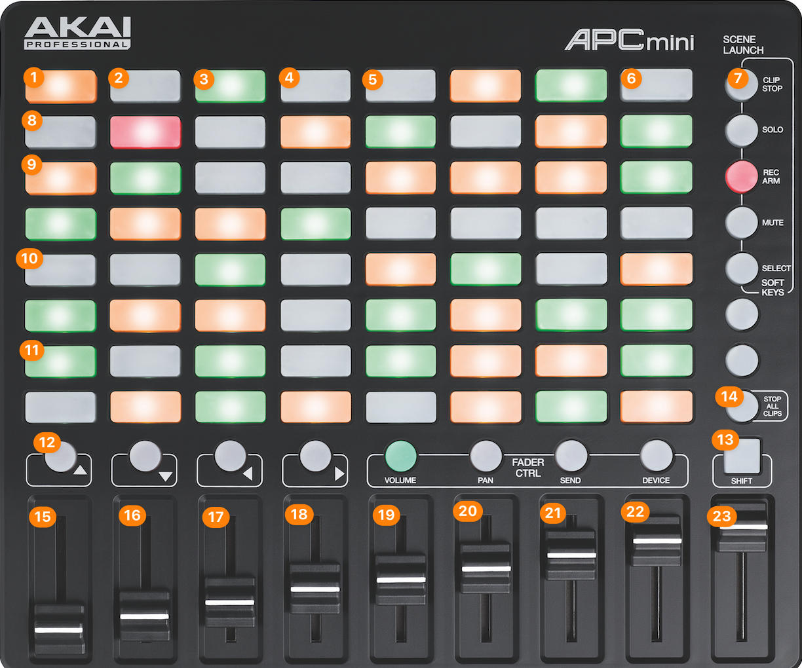

# Présentation

## À quoi sert Diffusion 3

Diffusion 3 est un plug-in de la suite CMGS (*Concrete Music Gran Studio*), destiné à la **diffusion**, ou
spatialisation, de sources multicanales sur une installation multicanale (un acousmonium). Il est programmé en JSFX,
et n'est donc utilisable que dans REAPER.

Le plug-in a été conçu d'abord pour diffuser facilement, sur une installation multicanale, des pièces
électroacoustiques stéréophoniques lues depuis un support tel qu'un disque compact. Le compositeur peut lui trouver
d'autres usages au moment de la création d'une pièce : il permet d'essayer rapidement la spatialisation d'une piste
multicanale sur son installation, ou de projeter en concert plusieurs sources (un instrument joué en direct, des pistes
d'accompagnement) sur l'ensemble des haut-parleurs.

## Capacités

| Élément | Nombre | Remarque |
|------------------------------|------------|----------------------------------------------------------|
| Canaux d'entrée et de sortie | 128 | ceux de la piste ; réglables (module Global) |
| Projecteurs (diffuseurs) | 16 | indépendants, fonctionnant simultanément |
| Diffusions | 4095 | numérotées de 1 à 4095 |
| Scènes | 16 | chacune de 16 groupes de 16 items |
| Channel sets | 511 | sélection et permutation de canaux |
| Présets de projecteurs | 512 | numérotés de 0 à 511, chargés par le fichier de configuration ou l'APCmini |
| Paquets d'actions | 16 | de 8 actions chacun |
| Fichiers de configuration | 9 | Diffusion-1.mSL à Diffusion-9.mSL |

Le nombre de projecteurs est fixé au début du fichier Diffusion-3.jsfx (`PRJ_CNT = 16`) ; les structures internes en
prévoient jusqu'à 24.

## Installation

Diffusion 3 fonctionne avec REAPER 7.25 ou plus récent. Le fichier Diffusion-3.jsfx et le dossier GM-Libs/ doivent se
trouver dans le dossier Effects/ de REAPER (dans la distribution CMGS, sous Effects/CMGS/GameMaster/). Le plug-in
apparaît dans la liste des effets sous le nom *Diffusion3 - 128 Channels - v4.0 - 2026*.

Le nombre de canaux utilisés en entrée et en sortie est, par défaut, celui de la piste sur laquelle le plug-in est
installé (jusqu'à 128).

Le plug-in lit au lancement un fichier de configuration, Diffusion-1.mSL, qui décrit les diffusions (voir « Les
fichiers de configuration »). Les dossiers où il le cherche dépendent de la variable `user_directory`, au début du
fichier Diffusion-3.jsfx, à adapter une fois pour toutes (voir « Où placer les fichiers »).

## Sauvegarde

Sont sauvés avec le projet REAPER (ou un préset) :

- les valeurs des curseurs du plug-in (le projecteur courant et ses réglages, les volumes, les canaux…) ;
- l'organisation de la fenêtre : onglets, panneaux, modules affichés, projecteur montré par chaque vue ;
- le volume de chaque projecteur (module Global) ;
- le thème, la taille et le style d'affichage.

Les réglages des projecteurs autres que le projecteur courant ne sont pas sauvés. Les diffusions, les scènes, les sets
et les présets ne le sont pas non plus : ils sont relus dans le fichier de configuration à chaque lancement (un préset
chargé par `pload` peut ainsi régler chaque projecteur au démarrage).

# Concepts

Le plug-in manipule des **diffusions**, chacune décrivant la manière dont un signal audio en entrée va être projeté sur
l'ensemble des haut-parleurs de l'installation.

## Diffusion

Une diffusion est représentée par une matrice N × P décrivant la diffusion de N canaux sources vers P canaux
destinations. Chaque coefficient de cette matrice (ligne i, colonne j) indique le volume de la diffusion du canal
source i vers le canal destination j. Une source i peut être projetée vers plusieurs destinations j1, j2, j3…, de même
qu'une destination j peut recevoir plusieurs sources i1, i2, i3… Les nombres N et P peuvent aller jusqu'à 128.

## Morphing

Le plug-in permet à tout moment de passer d'une diffusion (donc d'une matrice) à une autre. Ce passage se fait par un
**morphing** : une transformation progressive de chaque coefficient de la matrice de diffusion vers le coefficient
correspondant de la matrice *consigne*, qui représente la nouvelle diffusion désirée. Le passage se fait à puissance
constante : le volume audible ne varie pas pendant la transformation. Celle-ci s'accompagne cependant d'effets, en
général désirés : on peut par exemple avoir l'impression d'un déplacement du son d'un haut-parleur à l'autre.

## Channel set

Un *channel set* est une liste de canaux, qui permet de sélectionner et de permuter les canaux en entrée et en sortie
d'un projecteur. Au lieu de traiter l'ensemble des canaux de l'installation, la matrice de diffusion ne s'applique
alors qu'aux canaux sélectionnés. Ainsi, le set « 4 2 6 5 » fournit le canal physique 4 comme canal logique 1, le 2
comme canal 2, le 6 comme canal 3 et le 5 comme canal 4. Si le même set est utilisé en sortie, une diffusion écrite pour
les canaux 1 à 4 s'applique en fait aux canaux 4, 2, 6 et 5.

## Projecteur

Un **projecteur** (appelé aussi *diffuseur*) est un processus qui applique une matrice de diffusion à tout ou partie
des canaux d'entrée, vers tout ou partie des canaux de sortie. Si l'on sélectionne N canaux en entrée et P canaux en
sortie, en donnant au projecteur des channel sets de N et P éléments, une matrice N × P suffit pour réaliser cette
opération. Le plug-in fait fonctionner simultanément jusqu'à 16 projecteurs, indépendants les uns des autres, dont les
sorties s'additionnent.

Chaque projecteur a son état (Off, Active, Mute ou Solo), son mode de fonctionnement (manuel, aléatoire ou hyper
slider), sa diffusion courante, son temps de morphing, son volume. L'un d'eux est le **projecteur courant** : c'est
celui que règlent les curseurs du plug-in et la surface de contrôle.

## Scènes, groupes et items

Les diffusions sont rangées dans des **scènes**. Une scène est un ensemble de 256 items, arrangés en 16 **groupes** de
16 **items** ; chaque item est un numéro de diffusion. Choisir une scène, un groupe et un item revient donc à choisir
une diffusion ; l'item résultant porte le numéro 16 × (groupe − 1) + (item − 1), de 0 à 255, dans sa scène.

## Diffusion virtuelle

Il se peut que la diffusion de numéro N ne soit pas définie, mais que N+1, N+2… N+p le soient. N représente alors une
**diffusion virtuelle**, qui correspond à ce groupe de p diffusions définies : choisir la diffusion N revient à choisir
une diffusion au hasard parmi ces p diffusions. On accède ainsi, avec 256 items par scène, à bien plus de diffusions
effectives.

# L'interface

## Onglets, panneaux et modules

La fenêtre de Diffusion 3 est organisée comme celles des autres plug-ins CMGS : des **onglets** (Tab1, Tab2…, dont la
liste est en haut de la fenêtre), chacun de 1 à 4 **panneaux** (colonnes), et dans chaque panneau une pile de
**modules**. Par défaut, le premier onglet montre les modules Main Status, System Log, Memory 1 et Memory 2, et le
second l'écran Live.

Le menu des panneaux s'ouvre par Shift + clic droit n'importe où dans un panneau, ou par un clic droit simple là où il
n'y a pas de module. Il permet de :

- choisir les modules affichés (sous-menu Modules ; le sous-menu Projectors regroupe le module Projectors et les vues
  Projector A à H) ;
- déplacer, copier et coller un module ou un panneau, changer le nombre de panneaux et leurs largeurs, vider un panneau
  ou un onglet ;
- renommer un onglet ;
- choisir un thème de couleurs, une taille d'affichage (de 50 à 200 % ; Cmd + −, Cmd + + et Cmd + 0 la changent aussi)
  et un style d'affichage.

Tab et Shift + Tab passent à l'onglet suivant ou précédent ; Shift + ← et Shift + → changent la largeur des panneaux
sous la souris.

## Les pads

Les modules présentent des **pads** : des grilles de cellules, 8 par ligne. Comme dans tous les plug-ins CMGS :

- clic droit : un menu (choix d'un état, d'un mode, d'une valeur…) ;
- clic gauche : l'action la plus simple (passer à l'élément suivant, basculer un état) ;
- les cellules qui portent une valeur (durées, flou, volumes…) sont des **potentiomètres** : un glissé horizontal du
  bouton gauche parcourt toute la plage, un glissé vertical règle finement (1/10, vers le haut : plus) ; Shift + clic
  gauche rend la valeur par défaut ; un clic gauche seul ne fait rien.

Une valeur se tape aussi au clavier : un clic sur le libellé d'un fader (module Global) ouvre une fenêtre de saisie.

## Les curseurs natifs

Diffusion 3 déclare des curseurs JSFX, que REAPER montre dans le panneau de l'effet (la touche S les montre ou les
cache) et qui peuvent être automatisés ou appris par un contrôleur MIDI. Les modules ne font que les manipuler : changer
un réglage dans un pad revient à déplacer le curseur correspondant.

| Curseur | Rôle |
|------------------------------|----------------------------------------------------------------------|
| Current projector | le projecteur courant, de 1 à 16 |
| Projector status | l'état du projecteur courant : Off, Active, Mute, Solo |
| Volume (dB) | le volume général, de −120 à 0 dB |
| Volume adjust. (dB) | l'ajustement du volume, de −20 à +20 dB ; le gain est la somme des deux |
| Volume Responsivity (s) | la durée des changements de volume (0,01 à 60 s), et des mises en route et arrêts des projecteurs |
| Input Channels, Output Channels | le nombre de canaux utilisés en entrée et en sortie |
| Scene, Group, Item | le choix de la diffusion du projecteur courant (1 à 16 chacun) |
| Morphing time (s) | la durée du passage d'une diffusion à une autre (0,01 à 60 s) |
| Blur | le passage progressif en mono : à 0, chaque canal garde son individualité ; à 100, la somme des entrées est répartie sur toutes les sorties |
| Operating mode | Off, Manual, Random 1, 2, 4, 8, 16, Hyper Slider |
| Action | Clear (efface l'indicateur d'erreur), Change (une nouvelle diffusion au hasard), File 1 à File 9 (charge un fichier de configuration) |
| Debug 1 à 4 | réservés à la mise au point |
| Random delay (s) | le délai moyen entre deux changements aléatoires (0,01 à 900 s) |
| Hyper Slider, Ambitus | la position de l'hyper slider (0 à 1) et le nombre de diffusions qu'il parcourt (2 à 8) |

Les réglages d'un projecteur (état, mode, scène, groupe, item, morphing, flou, délai, hyper slider) sont ceux du
projecteur courant : changer de projecteur courant affiche ses propres valeurs.

# Le module Global

Le module **Global** regroupe les réglages généraux et les volumes. (Il s'appelait Diffusion : les projets anciens
montrent Global à sa place.)

| Cellule | Contenu | Souris |
|----------|-------------------------------------------------------|-----------------------------------|
| 0, 1 | Inputs n, Outputs n : le nombre de canaux utilisés en entrée et en sortie | menu (2 à 128) |
| 2 | Current: Pn, le projecteur courant | gauche : le suivant ; droit : menu |
| 3 | Run, Hold ou Freeze : l'état des changements | gauche : Run ↔ Freeze ; droit : menu |
| 4 | Resp. : la durée des changements de volume (Volume Responsivity) | potentiomètre ; droit : menu |
| 5 | Error nnnn ou No error : l'indicateur d'erreur | gauche : l'efface |
| 6 | File n : le dernier fichier de configuration chargé | menu : File 1 à File 9 |
| 7 | Debug on ou off | gauche : bascule ; droit : menu |

Run, Hold et Freeze agissent sur tous les projecteurs, comme la touche 1 de l'APCmini (voir « La surface de contrôle AKAI APCmini ») :

- **Run** : fonctionnement normal, changements aléatoires et morphings ;
- **Hold** : plus de changement aléatoire, les morphings en cours se poursuivent ;
- **Freeze** : plus aucun changement ni morphing ; la diffusion est figée.

Sous le pad, deux **faders** : Volume (−120 à 0 dB) et Adjust (−20 à +20 dB). Une ligne de texte donne le gain
résultant. Puis un fader par projecteur, sur deux colonnes si le module est assez large : le **volume du projecteur**,
de −120 dB (silence) à +12 dB. Il multiplie le niveau donné par l'état du projecteur (Active, Mute…), avec un lissage
d'environ 50 ms ; changer le volume d'un projecteur n'en fait pas le projecteur courant. Le libellé indique « Mute »
pour un projecteur qui n'est pas actif.

Sur les faders : clic droit, 0 dB ; double clic, la valeur par défaut ; clic sur le libellé, une fenêtre pour taper la
valeur.

# Les modules Projector A à H

Les huit **vues** Projector A à H montrent chacune les réglages d'un projecteur. Par défaut, la vue A montre le
projecteur 1, la vue B le projecteur 2, etc. ; la cellule 0 change le projecteur montré (le choix est sauvé avec le
projet). Le pad a deux lignes :

| Cellule | Contenu | Souris |
|----------|-------------------------------------------------------|-----------------------------------|
| 0 | Projector n (vert : le projecteur courant) | gauche : le suivant ; droit : menu |
| 1 | l'état : Off (gris), Active (vert), Mute (rouge), Solo (jaune) | gauche : Active ↔ Mute ; droit : menu |
| 2 | le mode : Off, Manual, Random 1 à 16, Hyper Slider | menu |
| 3, 4, 5 | Scene, Group, Item | menu (1 à 16) |
| 6 | New config : une nouvelle diffusion au hasard (selon le mode) | gauche |
| 7 | Current, ou Make current | gauche : le rend courant |
| 8 | Morph : le temps de morphing | potentiomètre ; droit : menu |
| 9 | Blur : le flou, en % | potentiomètre ; droit : menu |
| 10 | Delay : le délai des changements aléatoires (modes Random) | potentiomètre ; droit : menu |
| 11, 12 | Hyper et Ambitus (mode Hyper Slider) | potentiomètres ; droit : menu |
| 13 | Config n : la diffusion actuellement utilisée | — |
| 14 | Vol : le volume du projecteur | potentiomètre ; droit : menu |

Les cellules sans objet dans le mode du projecteur (Delay hors des modes Random, Hyper et Ambitus hors du mode Hyper
Slider) sont grisées. Comme avec les curseurs, changer un réglage d'un projecteur en fait le projecteur courant (sauf
son volume).

# Le module Projectors

Le module **Projectors** montre d'un coup d'œil les 16 projecteurs. Il est le premier élément du sous-menu Projectors
du menu des modules.

- Ligne 1 : Projectors, leur nombre (Count), leur nombre par état (Active, Mute, Solo, Off), le nombre de ceux qui
  sonnent (Sound : actifs, avec un niveau et un volume non nuls), et le projecteur courant (Current: Pn ; clic gauche :
  le suivant ; clic droit : menu).
- La grille : une cellule par projecteur, avec son numéro et son mode (« P3 Rnd 4 » ; le projecteur courant entre
  crochets), colorée par son état comme dans les vues. Clic gauche : Active ↔ Mute ; Alt + clic gauche : le montre dans
  une vue Projector de l'onglet ; clic droit : un menu (Make current, les états, Show in a view, Show in a new view).
- Le texte : le projecteur sous la souris (état, mode, scène, groupe, item, diffusion, volume, niveau).

# Le module Space 3D

Le module **Space 3D** est une vue en trois dimensions des haut-parleurs et de sources. C'est un outil d'étude et de
visualisation : il ne modifie pas le son.

Par défaut, les haut-parleurs sont ceux de la configuration de Diffusion 3 (leurs positions sont données par `hppos`
dans le fichier de configuration) ; les gains montrés sont ceux de la diffusion du projecteur courant, et les niveaux
ceux des sorties. On peut aussi y charger des configurations de GRM Spaces : déposer sur la fenêtre un fichier .lay (une
configuration) ou .ala (une bibliothèque), ou une trajectoire exportée en .xml.

Le pad a deux lignes :

- Ligne 1 : Options (vue en perspective ; menu des options d'affichage), HP (les haut-parleurs : Diffusion ou une
  configuration de la bibliothèque), Src (la configuration des sources), A et B (deux trajectoires), Mix (la trajectoire
  effective, entre A et B), View (face, côté, dessus, perspective), Anim (l'animation, en tours par minute).
- Ligne 2, le groupe des sources : Mouse (la souris agit sur la scène ou sur les sources), Frame (repère absolu ou lié
  à la trajectoire), Spread, Size, Yaw, Pitch, Roll, Reset.

Dans la vue : glisser fait tourner la scène, la molette zoome, un clic droit ouvre les options ; la touche h affiche les
gains et les niveaux en boules ou en croix et halos.

[Copie d'écran à refaire : le module Space 3D, avec les haut-parleurs de la configuration.]

# L'écran Live

Le second onglet montre par défaut l'**écran Live**, destiné au concert. Sur un fond coloré animé (ses couleurs limites
sont données par `bgcolor` dans le fichier de configuration), il affiche des boîtes : l'horloge ou un chronomètre,
l'état du projecteur courant, les commandes reçues de la surface de contrôle (encadrées de deux bordures jaunes quand
elles sont récentes), et la boîte des haut-parleurs (l'installation vue de dessus, de face, de côté ou en perspective,
avec les niveaux). La plupart des indications ne sont pas rémanentes : elles s'effacent au bout d'un certain temps.

[Copie d'écran à refaire : l'écran Live pendant un concert.]

Commandes au clavier (la souris dans la fenêtre du plug-in) :

| Touche | Action |
|---------------|-------------------------------------------------------------------------------------|
| g | afficher ou non l'interface graphique |
| c | afficher ou non l'horloge |
| t | passer de l'horloge au chronomètre, et inversement |
| z | remettre le chronomètre à zéro |
| p | afficher ou non l'état du projecteur courant |
| s | afficher ou non les curseurs du plug-in |
| r | réafficher toutes les informations |
| l | effacer les informations non rémanentes |
| a, x | rafraîchir l'affichage |
| C | faire varier ou non les couleurs du fond |
| b | afficher la couleur du fond |
| w | afficher la taille de la fenêtre |
| k | afficher ou non les touches frappées |
| m, v | afficher ou non la souris, les cases utilisées |
| u | passer à l'onglet suivant |
| j | changer la vue de la boîte des haut-parleurs |
| i | encadrer ou non la boîte des haut-parleurs |

Sur la boîte des haut-parleurs : = et : l'agrandissent ou la réduisent ; ? change de vue ; les flèches et Home
orientent la vue en perspective, ; et , changent sa distance ; $ et % montrent ou cachent les niveaux et les gains ;
/ choisit le fond (noir, ou celui de l'écran Live).

# Les modules système

Ces modules sont communs aux plug-ins CMGS : Main Status (l'état général : version, mémoire, threads mSL), System Log
(le journal ; la touche p l'écrit dans un fichier texte quand CMGS-auxiliary.eel est actif), Memory 1 et Memory 2
(l'inspection de la mémoire), Scheduler et Processes Manager (les tâches et les processus mSL).

# Les fichiers de configuration

## Description des diffusions

Avec 128 canaux en entrée comme en sortie, la matrice de diffusion compte 128 × 128 = 16 384 coefficients. En général,
elle est creuse : la plupart de ses coefficients sont nuls. Les diffusions sont donc décrites en indiquant les valeurs
des seuls coefficients non nuls :

```
i > j1 v1, j2 v2, ..., jk vk ;
```

où i est le numéro du canal source (1 à N), « > » se lit « va vers », jk est le numéro d'un canal destination, et vk le
volume (facultatif, 1 par défaut) associé à ce canal.

Les volumes s'interprètent ainsi :

- une valeur négative est en décibels : −1 devient 0,8912, −6 devient 0,5012 et −20 devient exactement 0,1 ;
- la valeur 0 donne toujours un volume nul ;
- les valeurs positives sont normalisées, indépendamment pour chaque canal source : si Vi1, Vi2… ViP sont les volumes
  d'envoi du canal source i vers les P haut-parleurs d'une diffusion, chacun est remplacé par sqrt(Vij / V), où
  V = max(1, Vi1 + Vi2 + … + ViP).

Les volumes d'une même source sont ainsi normalisés de sorte que la puissance transmise par l'ensemble des canaux
récepteurs soit égale à celle qu'aurait transmise la source vers une seule sortie. Par exemple :

```
1 > 1, 5 ;
```

envoie le canal d'entrée 1 vers les canaux 1 et 5. Les volumes omis valent 1, ce qui équivaut à `1 > 1 1, 5 1 ;` ; après
normalisation, on obtient `1 > 1 0.70710678, 5 0.70710678 ;` : la puissance transmise (la somme des carrés des volumes)
vaut bien 1.

Une diffusion qui échange les canaux gauche et droit s'écrit :

```
conf 85 : 1 > 2 ; 2 > 1 ;
```

Le mot-clé `conf` (ou `diff`) introduit une diffusion ; 85 est son numéro, choisi par l'utilisateur, de 1 à 4095 ; « : »
est facultatif. Les caractères « : », « > », « , » et « ; » simplifient la lecture de la description. Après le numéro,
`dB v` donne un volume global à la diffusion (en dB, au plus +20) : `conf 12 dB -6 : 1 > 1 ; 2 > 2 ;`.

Quelques exemples :

```
conf 10 : 1 > 1 ; 2 > 1 ;
conf 11 : 1>2 ; 2>2 ;
```

envoient la stéréo d'entrée en mono, la première sur le canal 1, la seconde sur le canal 2.

```
conf 6 : 1 > 1, 3 0.1, 5 0.3 ; 2 > 2, 3 0.1, 6 0.3 ;
conf 6 : 1 > 1, 3 -20, 5 -10 ; 2 > 2, 3 -20, 6 -10 ;
```

envoient une stéréo sur un 5.1 classique sans utiliser le caisson (canal 4) : une petite partie du volume va vers les
canaux 3 et 5 pour la gauche, 3 et 6 pour la droite ; la seconde écriture, en décibels, donne un résultat très proche.

```
conf 8 : 1 > 1, 3, 5, 7 ; 2 > 2, 4, 6, 8 ;
```

diffuse une stéréo sur une octophonie organisée en 4 paires gauche/droite : le canal gauche sur tous les haut-parleurs
de gauche, le droit sur tous ceux de droite.

Une écriture telle que `conf 33 : 1 > 1 0 ;` est autorisée : elle donne une matrice nulle, qui peut servir à faire un
fondu d'entrée ou de sortie.

## Scènes et groupes

Une scène est introduite par le mot-clé `scene` suivi de son numéro (1 à 16), puis de descriptions de groupes. Un
groupe est introduit par `group`, suivi de son numéro (1 à 16), puis d'une liste de 1 à 16 numéros de diffusions
(définies ou virtuelles) ; un groupe incomplet est complété par des 0.

## Un exemple de fichier

Le fichier ci-dessous a été conçu pour diffuser une stéréo sur une installation de quatre haut-parleurs.

```
D3_config(data(
// Configuration for "Diffusion 3"
vol -8
vadj 4
morpht 5
conf  16 :   1 > 1 3, 2 1 ;  2 > 2 ;
conf  17 :   1 > 3 ; 2 > 4 ;
conf  18 :   1 > 1, 2, 3 ; 2 > 4 ;
conf   3 :   1 > 2 ;  2 > 1 ;
conf   4 :   1 > 1, 3 ;  2 > 2, 4 ;
conf   5     1 > 1 ; 2 > 1 ;
conf   6     1 > 2 ; 2 > 2 ;
conf   7     1 > 3 ; 2 > 3 ;
conf   8     1 > 4 ; 2 > 4 ;
conf  21     1 > 2 ; 2 > 1 ;
conf  22     1 > 1 ; 2 > 2 ;
conf  31 :   1>1 ; 2>2 ; 3>3 ; 4>4 ;
conf  32 :   1>4 ; 2>3 ; 3>2 ; 4>1 ;
end
scene 1
group 1 :
    16 17 18 3 4 5 6 7 8
group 2 : 21 22
group 6
    5 6 7 8 5 6 7 8 5 6 7 8 5 6 7 8
end
)) ;
```

La première et la dernière ligne viennent de ce que le fichier est un script mSL, le langage de script de CMGS :
l'analyse de la description est faite par la fonction `D3_config`, qui reçoit la liste des mots écrits entre
`data(` et `)`. Les lignes qui commencent par `//` sont des commentaires. Pour le reste, le format est libre : les
unités (noms, nombres) sont séparées par des espaces, des tabulations ou des passages à la ligne. Le mot-clé `end`
termine une suite de déclarations.

## Les mots-clés

| Mot-clé | Rôle |
|-------------------------|---------------------------------------------------------------------------|
| clear | efface toutes les définitions (diffusions, sets, scènes, présets) |
| conf n, diff n | une diffusion (voir plus haut) ; `dB v` après le numéro : son volume global |
| scene n | une scène (1 à 16), suivie de ses groupes |
| group n | un groupe (1 à 16), suivi de 1 à 16 numéros de diffusions |
| set n | un channel set (1 à 511) : une suite sans répétition de numéros de canaux, de 1 à 128 |
| vol v | la valeur initiale du Volume, de −120 à 0 dB |
| vadj v | la valeur initiale de l'ajustement de volume, de −20 à +20 dB |
| morpht t | la valeur initiale du temps de morphing, de 0,01 à 60 s |
| opmod m | le mode de fonctionnement : 0 Off, 1 Manual, 2 à 6 Random 1 à 16, 7 Hyper Slider |
| rdelay t | le délai des changements aléatoires, de 0,01 à 900 s |
| defaultconf n | la diffusion utilisée à la place d'une diffusion qui n'existe pas (1 par défaut) |
| pad n1 n2 ... | les 16 diffusions toujours accessibles sur le pad de l'APCmini |
| remove conf n | retire une diffusion (de même `remove set n`, `remove prop n`) |
| prop n ( ... ) | un préset de projecteur (voir plus bas) |
| pload p n | charge le préset n dans le projecteur p |
| actions n : ... ; | un paquet d'actions (voir plus bas) |
| hppos h < x y z, ... ; | la position des haut-parleurs h (x, y, z entre −5 et 5), pour l'écran Live et le module Space 3D |
| bgcolor c1 c2 | les couleurs limites du fond de l'écran Live (0xRRGGBB) |
| end | ferme les déclarations conf, group, scene… (facultatif) |

Si aucune diffusion n'est trouvée pour un item, le plug-in utilise la diffusion `defaultconf` ; si elle n'est pas
définie non plus, une stéréo classique sur les canaux 1 et 2 (`1 > 1 ; 2 > 2 ;`).

## Les présets de projecteurs

Un préset de projecteur décrit un ensemble de valeurs qui règlent un projecteur. Il se compose du mot-clé `prop`, d'un
numéro de préset (0 à 511), d'une parenthèse ouvrante, d'une liste de déclarations et d'une parenthèse fermante. Les
déclarations possibles sont :

- `default` : toutes les caractéristiques du projecteur reçoivent leur valeur par défaut ; sans ce mot-clé, elles sont
  « indéfinies » ;
- l'état du projecteur après le chargement : `Off`, `Active`, `Mute` ou `Solo` ;
- le mode : `Manual`, `Random1`, `Random2`, `Random4`, `Random8`, `Random16` ou `HyperSlider` ;
- `morpht t` : le temps de morphing (0,01 à 60 s) ; `rdelay t` : le délai des changements aléatoires (0,01 à 900 s) ;
- `inset n`, `outset n` : les channel sets utilisés en entrée et en sortie ;
- `sgi s g i` : la scène, le groupe et l'item de la diffusion chargée aussitôt ;
- `pad s g i` : le point de départ d'une suite de 16 diffusions accessibles sur le pad de l'APCmini (`pad 1 1 1` : les
  16 premières diffusions des déclarations scene et group) ;
- `color c` : une couleur (0 à 15), qui distingue ce préset sur la surface de contrôle.

Au chargement d'un préset, ses valeurs qui ne sont pas indéfinies remplacent celles du projecteur : un préset peut ne
modifier que quelques réglages. Avec :

```
prop 15 (Active Manual sgi 3 2 8 morpht 12)
prop 16 (Off)
```

le préset 15 active un projecteur, en chargeant la diffusion 8 du groupe 2 de la scène 3, avec un morphing de 12
secondes ; le préset 16 arrête le projecteur.

## Les paquets d'actions

Le plug-in propose des **opérations internes**, désignées par un numéro et suivies de leurs opérandes. Une action est
une opération, ou une suite d'opérations séparées par « + » ; un paquet regroupe jusqu'à 8 actions, séparées par des
virgules. Le fichier de configuration peut définir 16 paquets ; chaque action est une touche de l'APCmini (page Rec
Arm, voir « Les autres pages ») :

```
actions 2 : 6 -1, 8, 0, 9 1 + 3 1 + 5 1 ;
```

Ce paquet 2 contient quatre actions : l'opération 6 avec l'opérande −1, l'opération 8 sans opérande, une action vide
(0), puis une suite qui sélectionne l'onglet Live (9 1), affiche l'horloge (3 1) et la passe en chronomètre (5 1).

| Opération | Effet |
|---------------|-------------------------------------------------------------------------------------|
| 0 | aucun |
| 1 x | l'interface graphique : −1 bascule, 0 la cache, 1 la montre |
| 2 x | les curseurs natifs : −1 bascule, 0 les cache, 1 les montre |
| 3 x | l'horloge : −1 bascule, 0 la cache, 1 la montre |
| 4 x | 1 : réaffiche tout |
| 5 x | −1 bascule horloge / chronomètre, 0 l'horloge, 1 le chronomètre |
| 6 x | l'état du projecteur courant : −1 bascule, 0 le cache, 1 le montre |
| 7 | affiche la couleur du fond |
| 8 | affiche la taille de la fenêtre |
| 9 x | l'onglet : −1 le suivant, sinon l'onglet x (0 : le premier) |
| 10 x | règle le chronomètre à x secondes (négatif : il décompte) |
| 11 | efface les informations non rémanentes |
| 12 f ... | appelle la fonction mSL f, avec les opérandes qui suivent |

## Où placer les fichiers

On peut définir et utiliser 9 fichiers de configuration, Diffusion-1.mSL à Diffusion-9.mSL. Diffusion-1.mSL est lu au
lancement ; le menu de la cellule File du module Global, ou le curseur Action (File 1 à File 9), en charge un autre à
tout moment. Un fichier de configuration peut aussi être déposé sur la fenêtre du plug-in, comme tout script mSL.

REAPER ne donne pas à un plug-in JSFX le dossier de l'utilisateur. Le plug-in cherche donc les fichiers, dans cet ordre :
sous leur nom seul, puis dans cinq dossiers définis au début de Diffusion-3.jsfx-inc à partir de la variable
`user_directory` de Diffusion-3.jsfx :

```
user_directory = "/Users/jjg4"
#path1 = "<user_directory>/Music/REAPER-Projects/Diffusion-Test-1/Data/Diffusions"
#path2 = "<user_directory>/Diffusions"
#path3 = "<user_directory>/REAPER/Diffusions"
#path4 = "Diffusions"
#path5 = "<user_directory>/Library/Application Support/REAPER/Data/Diffusions"
```

Il faut donc remplacer, une fois pour toutes, la valeur de `user_directory` par son propre dossier (garder une copie de
l'original). Le chemin 4 est relatif au dossier Data de REAPER ; les autres sont absolus.

# Utilisation

## Un exemple de mise en œuvre

[Copie d'écran à refaire : les pistes de REAPER, et le routage de la piste du plug-in.]

Une première piste porte le plug-in dans sa liste d'effets. Un APCmini d'AKAI est utilisé comme contrôleur. Pour cette
piste, on a choisi 32 canaux, ce qui permet d'utiliser tous les haut-parleurs de l'installation. Son entrée MIDI est le
contrôleur, et sa sortie « MIDI Hardware Output » est dirigée vers le même contrôleur, qui donne ainsi un retour visuel
à l'utilisateur.

Cette piste reçoit les signaux de ses sous-pistes, chacune de deux canaux, toutes dirigées vers la piste mère. La piste
2 est en enregistrement et reçoit un signal stéréo de l'entrée 2-3 de la carte son : un instrument joué en direct, qui
va sur les canaux 1-2 de la piste mère. Les pistes 3 et 4 sont des pistes d'accompagnement en stéréo, envoyées sur les
canaux 3-4 et 5-6. Le plug-in reçoit ainsi six canaux, qu'il projette sur les 32 de l'installation.

## Choisir une diffusion

La scène, le groupe et l'item (curseurs, vues Projector, APCmini) choisissent une diffusion parmi les 4096 items des
scènes. L'item désigne une diffusion définie, une diffusion virtuelle, ou une diffusion qui n'existe pas : dans ce cas,
le plug-in utilise la diffusion par défaut (voir `defaultconf`). La cellule Config d'une vue Projector donne le numéro
de la diffusion effectivement utilisée.

## Passer d'une diffusion à une autre

Le plug-in applique aux entrées une matrice de redirection. À tout moment, une nouvelle consigne peut être choisie : le
plug-in transforme alors progressivement la matrice de diffusion pour la rendre identique à la consigne, en un temps
donné par le temps de morphing (Morph). Ce processus sous-tend toutes les opérations : changements manuels ou
automatiques de diffusion, hyper slider.

En mode **Manual**, l'utilisateur choisit lui-même les diffusions. Dans les modes **Random**, le plug-in passe au hasard
d'une diffusion à une autre : en Random 1, parmi les 16 items du groupe choisi ; en Random 2, parmi les 32 items de ce
groupe et du suivant ; de même en Random 4, 8 et 16, parmi les items de 4, 8 ou 16 groupes à partir du groupe choisi
(les groupes étant pris modulo 16). Le délai entre deux changements (Delay) est aléatoire : pour une valeur D, il est
compris entre 0,5 × D et 1,5 × D. New config (ou Change) provoque aussitôt un nouveau choix.

## Le mode Hyper Slider

Ce mode permet de passer graduellement, et manuellement, d'une diffusion à une autre, par une interpolation sin/cos, à
puissance constante. L'interpolation se fait entre 2 à 8 diffusions, selon l'**Ambitus**. Les diffusions viennent du
groupe choisi ; la première est l'item choisi, les autres le suivent, circulairement dans le groupe. Ainsi, avec :

```
group 6 : 25 26 28 52 53 54 55 57 12 13 26 41 42 43 44 45
```

si l'item vaut 4 et l'ambitus 5, l'hyper slider parcourt les diffusions 52 53 54 55 57 ; si l'item passe à 14, les
diffusions deviennent 43 44 45 25 26. L'hyper slider peut être confié à un potentiomètre d'une surface de contrôle. Le
déplacer crée une nouvelle consigne, que le morphing suit : un temps de morphing minimal rend l'hyper slider plus vif.

## Geler la diffusion

La cellule Run / Hold / Freeze du module Global (ou la touche 1 de l'APCmini) arrête les changements aléatoires (Hold),
ou fige toute la diffusion (Freeze), pour tous les projecteurs.

## Les volumes

Le gain général est la somme du Volume et de l'ajustement (Adjust), en dB. Chaque projecteur a en plus son propre volume
(module Global, cellule Vol des vues). Les changements de volume, ainsi que les mises en route et les arrêts des
projecteurs, se font progressivement, en un temps réglé par la Volume Responsivity (Resp.).

# La surface de contrôle AKAI APCmini

## Présentation

Bien que l'interface de Diffusion 3 donne accès à toutes ses fonctions, une utilisation en concert demande une surface
de contrôle MIDI. L'expérience montre que plus une surface est complexe et évoluée (et donc chère), moins il est facile
de l'adapter à un usage que son concepteur n'a pas prévu. L'APCmini d'AKAI, par sa simplicité et son faible coût, s'y
prête bien. Son module est inclus dans le plug-in (AKAI-APCmini.jsfx-inc) ; il peut être laissé sans conséquence si
l'on n'en dispose pas.

L'APCmini (commercialisé en 2009, remplacé depuis 2022 par l'APCmini MK2) est une surface de contrôle MIDI de coût
très modéré. Elle comporte 64 touches rectangulaires, qui peuvent s'éclairer en vert, jaune ou rouge, 8 touches rondes
disposées verticalement à leur droite, 8 touches rondes disposées horizontalement en dessous, une touche carrée
« Shift », et 9 potentiomètres linéaires (*faders*). Le module est entièrement compatible avec l'APCmini MK2.

{width=15cm}

La plupart des interactions réalisées avec le contrôleur sont reflétées dans l'écran Live du plug-in. Les boutons de
l'APCmini agissent sur les projecteurs 1 à 8 ; les projecteurs 9 à 16 se règlent dans les modules du plug-in.

## Les touches de la page principale

Les 64 touches changent de rôle selon la **page** choisie par les boutons ronds de droite (voir plus bas). Sur la page
principale (bouton 7), elles ont les fonctions suivantes :

| N° | Fonction |
|------------------|----------------------------------------------------------------------------------|
| 1 | verrouillage du morphing. Un appui (la touche passe du vert au rouge) interrompt aussitôt le morphing de la consigne vers la matrice de diffusion (Freeze). Un nouvel appui (la touche passe au jaune) débloque le morphing, mais interdit tout changement de diffusion (Hold). Le bouton 7 ramène au fonctionnement normal (Run). C'est la cellule Run / Hold / Freeze du module Global. |
| 2 | bascule entre le mode manuel et le mode aléatoire choisi auparavant : vert en mode manuel, jaune en mode aléatoire. |
| 3 | passage en mode hyper slider sur les dernières diffusions utilisées : la touche devient rouge un instant, puis jaune. L'hyper slider (potentiomètre 19) parcourt alors les dernières diffusions, dont le nombre est réglé par l'ambitus (potentiomètre 20). Le bouton 7 ramène au mode normal. |
| 4 | choix au hasard d'une diffusion du groupe courant : la touche devient rouge un instant, et la diffusion choisie s'éclaire en vert. |
| 5 | choix au hasard d'une diffusion du `pad` : la touche devient rouge un instant, et la diffusion choisie s'éclaire en vert. |
| 6e touche de la rangée | l'horloge de l'écran Live. Un appui bref la montre, et passe de l'horloge au chronomètre ; un appui long (1 à 6 secondes) la cache ; un appui long en tenant Shift remet le chronomètre à zéro. |
| 7e touche de la rangée | l'affichage graphique. Un appui bref le montre (et montre ou cache les curseurs natifs) ; un appui long (1 à 6 secondes) l'arrête. |
| 6 | état du projecteur courant : éteint (Off), vert (Active), rouge (Mute), jaune (Solo). Un appui bref passe d'un état actif à un autre ; un appui d'au moins trois secondes le met à Off. |
| 8 | la ligne d'état des projecteurs 1 à 8, avec les mêmes couleurs et les mêmes appuis que la touche 6. |
| 9 | cette ligne et la suivante, éclairées en jaune, représentent les 16 diffusions du groupe courant, numérotées de gauche à droite : de 9 à 16 sur la ligne du haut (la troisième du pad), de 1 à 8 sur celle du dessous. Un appui charge directement la diffusion : elle s'éclaire en rouge un instant, puis en vert jusqu'au choix d'une autre. |
| 10 | cette ligne et la suivante, éclairées en vert, représentent les 16 groupes de la scène courante, numérotés de la même façon. Un appui change de groupe, sans changer de diffusion : le groupe s'éclaire en rouge un instant, puis en jaune. |
| 11 | cette ligne et la suivante, éclairées en jaune, représentent les 16 diffusions du `pad`, déclarées dans le fichier de configuration et toujours accessibles. Un appui charge directement la diffusion, comme pour la touche 9. |
| 12 | cette rangée de 8 boutons choisit le projecteur courant (1 à 8), celui sur lequel agissent les réglages et les choix de diffusion. Son bouton est allumé fixe si le projecteur est actif, clignotant s'il est Off ou Mute. Un appui prolongé (1 à 6 secondes) le fait passer d'Active à Mute, et inversement. |
| 13 | la touche Shift rallume toutes les diodes du contrôleur (par exemple quand il a été débranché puis rebranché). |

Les changements d'état des projecteurs (Off, Active, Mute…) ne sont pas instantanés : ils s'accompagnent d'un fondu,
dont la durée est la Volume Responsivity.

## Les potentiomètres

| N° | Réglage |
|------------|----------------------------------------------------------------------------------------|
| 15 | le temps de morphing |
| 16 | le délai des changements aléatoires |
| 17 | la Volume Responsivity |
| 18 | la scène |
| 19 | l'hyper slider |
| 20 | l'ambitus de l'hyper slider |
| 21 | le flou (Blur) : la part du son des canaux sélectionnés envoyée sur tous les canaux de l'installation |
| 22, 23 | l'ajustement du volume : il est la somme des deux potentiomètres ; tous deux à zéro, il vaut 0 dB ; monter le 23 augmente le volume jusqu'à +20 dB, monter le 22 le baisse jusqu'à −20 dB |

Quand on manipule un potentiomètre, les deux lignes du bas du pad deviennent un instant un indicateur approximatif de sa
position : une touche s'éclaire en rouge si le potentiomètre est **désynchronisé** (sa position ne correspond pas à la
valeur que connaît le plug-in), en vert dès que la synchronisation est faite. Tant qu'il n'est pas synchronisé, le
potentiomètre ne modifie pas le réglage : il faut d'abord l'amener à la position de la valeur courante. Les
potentiomètres agissent sur la page principale et sur la page des diffusions du pad.

## Les autres pages

Les boutons ronds de la colonne de droite choisissent la page des 64 touches ; le bouton de la page affichée est
allumé, et clignote quand un second appui a choisi sa variante.

- **Bouton 7 (Clip Stop)** : la page principale décrite plus haut ; chaque appui rétablit aussi le fonctionnement
  normal (fin du verrouillage et de l'hyper slider). Un second appui affiche les 64 diffusions qui suivent le début
  du `pad` sur l'ensemble des touches (un appui charge la diffusion) ; un nouvel appui revient à la page principale.
- **Bouton Solo (sous le 7)** : les présets de projecteurs 0 à 63, numérotés de bas en haut et de gauche à droite. Une
  touche est éclairée (dans la couleur `color` du préset) si le préset existe, éteinte sinon. Un appui charge le préset
  dans le projecteur courant. Un second appui sur le bouton affiche les présets 64 à 127 (pour l'instant, ils ne sont
  qu'affichés : un appui ne les charge pas).
- **Bouton Rec Arm** : les actions des paquets 1 à 8, une rangée par paquet en partant du bas, une touche par action,
  dans la couleur du paquet. Un appui exécute l'action. Un second appui affiche les paquets 9 à 16 (pour l'instant,
  sans pouvoir les exécuter).
- Les autres boutons de la colonne choisissent des pages encore inutilisées (toutes les touches éteintes).

## Mise en œuvre

Pour utiliser la surface de contrôle, il faut s'assurer qu'elle est connue du système (sous macOS, dans « Configuration
audio et MIDI »), et qu'elle est utilisable par REAPER (Preferences, Audio, MIDI Inputs et MIDI Outputs). Il suffit
ensuite de mettre la piste qui porte Diffusion 3 en entrée MIDI sur cette surface, et d'ajouter dans son routage la même
surface en sortie MIDI (*MIDI Hardware Output*), afin que le plug-in puisse en éclairer les touches.

[Copie d'écran à refaire : le routage de la piste du plug-in, avec la sortie MIDI vers l'APCmini.]

Si le câble MIDI est débranché, il suffit de rebrancher la surface pour qu'elle soit de nouveau utilisable (la touche
Shift accélère l'opération).

Avec un APCmini MK2, choisir le périphérique « Mini MK2 - Control », et appuyer sur Shift après l'éclairage de la
surface pour la passer en mode MK2. Les couleurs affichées sont alors différentes de celles indiquées ici.

# Les scripts mSL

Diffusion 3 contient l'interpréteur mSL (*micro Script Language*) de CMGS. Un fichier .mSL déposé n'importe où dans la
fenêtre est compilé et exécuté : c'est ainsi que sont lus les fichiers de configuration, qui appellent `D3_config`. Un
script peut aussi échanger des messages avec les autres plug-ins CMGS (le Game Master, Interstys…), ou être appelé par
une action (opération 12). Le langage est décrit dans le manuel du Game Master.

# Le clavier

Diffusion 3 suit le schéma de clavier commun à CMGS : une touche est d'abord proposée au module sous la souris, puis au
panneau, à l'onglet (l'écran Live), aux commandes du plug-in, enfin aux commandes système. La liste complète est dans
Documents/CMGS-Keys.md.

| Touche | Niveau | Action |
|----------------------------|--------------|----------------------------------------------------------|
| Cmd+-, Cmd++, Cmd+0 | plug-in | taille d'affichage : plus petite, plus grande, 100 % |
| Tab, Shift+Tab | plug-in | onglet suivant, précédent |
| Shift+←, Shift+→ | panneau | largeur des panneaux |
| S | plug-in | montrer ou cacher les curseurs natifs dans le panneau de REAPER |
| h | Space 3D | gains et niveaux en boules, ou en croix et halos |
| g, c, t, z, p… | écran Live | voir « L'écran Live » |
| p | System Log | écrire le journal dans un fichier texte |

# Les codes d'erreur

L'indicateur d'erreur apparaît dans la cellule Error du module Global (un clic gauche l'efface) ; les messages
détaillés sont écrits dans le journal (module System Log).

## Le chargement d'un fichier

| Code | Sens |
|------------|----------------------------------------------------------------------------------------|
| 0100 | numéro de fichier de configuration inconnu |
| 0101 | fichier de configuration non trouvé |
| 2407 | trop de fichiers à compiler : le fichier est ignoré |
| 2438 | D3_config : l'argument n'est pas une liste de mots (data(...)) |

## L'analyse de la configuration

Une erreur dans la description arrête l'analyse ; le journal indique l'état de l'analyseur, le mot fautif et sa
position, puis « Set Table end - xErr = n ».

| Code | Sens |
|------------|----------------------------------------------------------------------------------------|
| 201 | le numéro de set est déjà utilisé |
| 202 | le numéro de diffusion est déjà utilisé |
| 203 | erreur de syntaxe dans une déclaration de diffusion |
| 204 | numéro de canal incorrect ou manquant dans une diffusion ou un set |
| 205 | erreur de syntaxe dans une déclaration de set |
| 206 | le caractère « > » est attendu |
| 207 | numéro de paquet d'actions incorrect (1 à 16) |
| 208 | numéro d'opération incorrect dans un paquet d'actions |
| 209 | un volume est attendu après dB |
| 210 | conf, set ou prop est attendu après remove |
| 211 | numéro de groupe manquant ou incorrect |
| 212 | numéro de diffusion attendu après remove conf |
| 213 | diffusion non définie (dans un groupe, ou après pad) |
| 214 | trop de diffusions après pad |
| 215 | plus de 16 diffusions dans un groupe |
| 216 | volume incorrect (vol) |
| 217 | ajustement de volume incorrect (vadj) |
| 218 | temps de morphing incorrect (morpht) |
| 219 | mode incorrect (opmod) |
| 220 | délai aléatoire incorrect (rdelay) |
| 221 | numéro de set attendu après remove set |
| 222 | numéro de scène attendu |
| 223 | le numéro de préset est déjà utilisé |
| 224, 225 | numéro de préset ou parenthèse attendus après prop |
| 226, 227 | déclaration incorrecte dans un préset |
| 228 | valeur de morpht attendue dans un préset |
| 229 | valeur de rdelay attendue dans un préset |
| 230 | set non défini (inset, outset) |
| 231 | numéro de set attendu (inset, outset) |
| 232 | numéro de canal répété dans un set |
| 233 | numéro de diffusion attendu après defaultconf |
| 234 | numéro de scène attendu (sgi, pad) |
| 235 | numéro de projecteur attendu (pload) |
| 236 | préset non défini (pload) |
| 237 | numéro de préset attendu (pload) |
| 238 | numéro de préset attendu après remove prop |
| 239, 240 | numéro de couleur attendu (color) |
| 250 | numéro de haut-parleur attendu (hppos) |
| 251 | « < » attendu (hppos) |
| 252, 253, 254 | position x, y ou z attendue, entre −5 et 5 (hppos) |
| 255 | « , » ou « ; » attendu (hppos) |
| 261 | couleur attendue, de 0 à 0xFFFFFF (bgcolor) |

## Erreurs internes

| Code | Sens |
|------------|----------------------------------------------------------------------------------------|
| 0621 | set(`ParamV, ...) : ce paramètre appartient à un autre plug-in |
| 0710 | erreur interne de libération de mémoire |
| 0711 | erreur interne : mémoire saturée |
